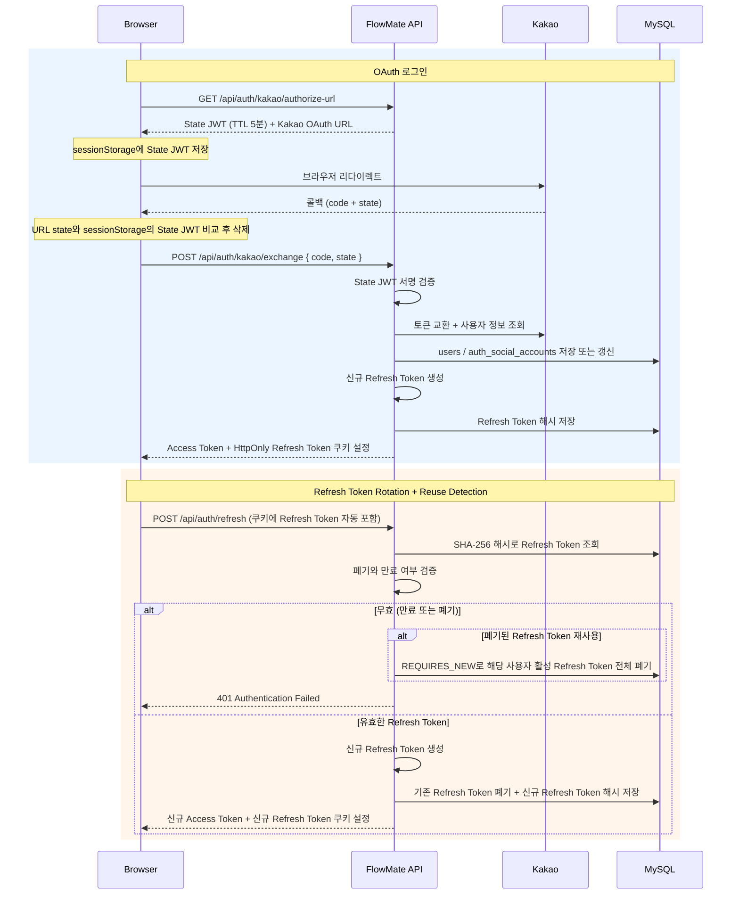

# 임시 식별자에서 토큰 탈취 대응까지: 인증 구조 4단계 진화

> 관련 문서: [폐기된 Refresh Token 재사용 시 롤백되던 전체 로그아웃: revoke-all 트랜잭션 분리](auth-reuse-detection-rollback.md)

## 요약

- **[문제]** 처음엔 토큰 없이 헤더의 UUID 형식만 확인해 **사칭 가능**, 이후 회원 로그인, 멀티디바이스, 토큰 탈취 대응이 차례로 필요해짐
- **[해결]** **UUID 헤더 → JWT → 기기별 Refresh Token 회전 → 재사용 탐지** 순서로 인증 구조를 4단계에 걸쳐 바꿈
- **[결과]** 서명된 토큰으로 게스트와 회원 검증, **새 기기로 로그인해도 기존 기기 유지**, 폐기 토큰 재사용은 탈취 신호로 보고 **전체 로그아웃**

## 1. 배경: 인증 구조 4단계 개요

초기 MVP는 백엔드 없이 localStorage만으로 데이터를 관리하며 제품 흐름을 먼저 검증했다. 백엔드를 붙이면서 사용자를 구분해야 했고, 이후 앞 단계의 한계가 드러날 때마다 인증 구조를 아래 네 단계로 바꿨다.

| Phase   | 시점               | 핵심 변화                                          | 계기                              |
|---------|------------------|------------------------------------------------|---------------------------------|
| Phase 1 | 2026-01-31~02-26 | `X-Client-Id` 헤더로 게스트 식별               | 로그인 없이 Todo와 타이머 기능부터 검증         |
| Phase 2 | 2026-02-27       | 게스트와 회원 JWT 분리 + Kakao OAuth                    | UUID 헤더는 형식만 확인해 사칭 가능            |
| Phase 3 | 2026-03-01       | 멀티디바이스 로그인 + Refresh Token Rotation            | 로그인할 때마다 다른 기기의 세션을 끊음            |
| Phase 4 | 2026-04-21~04-25 | Reuse Detection(재사용 탐지)                       | 회전으로 폐기된 토큰이 다시 들어와도 대응이 없음       |

## 2. Phase 1: X-Client-Id 기반 게스트 식별

| 구분 | 내용                                                        |
|----|-----------------------------------------------------------|
| 요구 | 로그인 없이 Todo와 타이머 기능을 먼저 검증                                |
| 결정 | 브라우저가 만든 UUID를 `X-Client-Id` 헤더로 보내 게스트 식별 |
| 결과 | 빠른 제품 검증은 가능했지만, 서명과 만료가 없는 브라우저 입력값이라 인증 수단으로 계속 쓰기는 어려움 |

프론트엔드가 브라우저 UUID를 localStorage에 저장하고 `X-Client-Id` 헤더로 보냈다. 백엔드는 UUID 형식만 검증했다.

복잡한 서버 세션이나 OAuth 없이 사용자별 데이터를 나눌 수 있어 초기 MVP에선 합리적이었다. 다만 신원 증명이 아니라 형식 검증에 불과해, 다른 사용자의 UUID를 그대로 헤더에 넣으면 그 사용자로 사칭할 수 있었다.

## 3. Phase 2: 게스트와 회원 JWT 분리 도입

| 구분 | 내용                                                                         |
|----|----------------------------------------------------------------------------|
| 요구 | 게스트와 회원을 구분하고, Kakao OAuth 로그인 후 회원 세션 유지                                  |
| 결정 | 게스트와 회원 JWT 분리, Access Token은 메모리, Refresh Token은 HttpOnly 쿠키, State JWT 도입 |
| 결과 | 서명된 토큰으로 사용자를 검증하고, 장기 토큰 노출 위험을 줄이는 구조로 변경                                  |

세션 기반 인증도 검토했지만 JWT를 선택했다. 게스트와 회원을 같은 `Authorization` 헤더 방식으로 인증할 수 있고, Access Token은 서명만으로 검증해 요청마다 세션 저장소를 보지 않으므로 서버를 여러 대로 늘려도 세션을 맞출 필요가 없기 때문이다. DB는 Refresh Token을 확인하는 refresh 때만 본다.

Spring Security OAuth2 Client도 검토했지만, OAuth 흐름을 직접 이해하기 위해 수동 구현을 선택했다.

### 토큰 정책

| 토큰            | 저장 위치            | TTL | 판단                             |
|---------------|------------------|-----|--------------------------------|
| Guest JWT     | `localStorage`   | 90일 | XSS 위험보다 재방문 연속성 우선            |
| Access Token  | 브라우저 메모리         | 15분 | 저장소를 읽는 XSS에는 노출되지 않고, 새어 나가도 15분 뒤 만료 |
| State JWT     | `sessionStorage` | 5분  | 서명 검증과 로그인을 시작한 탭의 값 비교로 CSRF 방어 |
| Refresh Token | HttpOnly 쿠키      | 14일 | 무작위 UUID, JS 접근 차단, 서버엔 SHA-256 해시만 저장 |

## 4. Phase 3: 멀티디바이스 로그인과 Refresh Token Rotation

| 구분 | 내용                                                           |
|----|--------------------------------------------------------------|
| 요구 | SSE 도입을 앞두고 데스크톱, 모바일 등 다른 브라우저에서도 같은 계정을 동시에 유지 필요             |
| 결정 | 로그인 시 기존 활성 Refresh Token 유지, refresh 성공 시 현재 토큰만 회전         |
| 결과 | 브라우저마다 회전하며 이어지는 Refresh Token chain이 생기고, 새 브라우저 로그인이 기존 브라우저를 끊지 않게 됨 |

타이머 [SSE 동기화](sse-sync.md)를 준비하면서 멀티디바이스 세션이 필요해졌다. 그전까지는 로그인할 때마다 기존 활성 Refresh Token을 모두 폐기하고 새로 발급했다. 단순하지만, 데스크톱을 쓰다 모바일에서 로그인하면 데스크톱이 로그아웃된다. 여러 기기에서 같은 타이머를 보려는 목표와 맞지 않아, 로그인 시 기존 Refresh Token을 그대로 두도록 바꿨다.

같은 변경에서 refresh도 바꿨다. 그전 `refresh()`는 Access Token만 새로 발급하고 Refresh Token은 그대로 둬, 탈취된 Refresh Token을 만료(14일)까지 쓸 수 있었다. 그래서 refresh마다 현재 토큰을 폐기하고 새로 발급하는 Refresh Token Rotation을 함께 넣었다.

정상 흐름은 다음과 같다.

```text
브라우저 A: RT-A1로 /api/auth/refresh
서버:      RT-A1 revoke
서버:      RT-A2 발급 + cookie 교체

브라우저 B: RT-B1로 /api/auth/refresh
서버:      RT-B1 revoke
서버:      RT-B2 발급 + cookie 교체
```

각 브라우저는 자신만의 Refresh Token chain을 가진다(쿠키 단위라 '기기별'은 정확히는 브라우저별이다). 회전하면 토큰 하나를 쓸 수 있는 기간이 다음 refresh까지로 줄어든다. 또 회전으로 폐기된 토큰은 정상 기기가 다시 보낼 일이 없으므로, 그런 토큰이 들어오면 이상 신호로 볼 수 있다. 이 신호를 활용한 것이 다음 단계다.

## 5. Phase 4: Reuse Detection

| 구분 | 내용                                                                        |
|----|---------------------------------------------------------------------------|
| 요구 | 멀티디바이스와 Refresh Token Rotation은 유지하면서, 폐기된 토큰이 다시 들어오면 탈취로 보고 대응 |
| 결정 | 폐기된 Refresh Token 재사용 시에만 활성 Refresh Token 전체 폐기                          |
| 결과 | 폐기된 토큰 재사용을 탈취 신호로 보고 활성 Refresh Token 전체를 폐기(revoke-all). 처음엔 이 폐기가 롤백돼 반영되지 않아, 트랜잭션을 분리해 고침(아래) |

Phase 3까지는 회전으로 폐기된 토큰이 다시 들어와도 만료와 구분 없이 같은 오류만 반환했다. 재사용 경로를 만료와 나눠 revoke-all 분기를 넣었다.

[RefreshToken.java](../../backend/src/main/java/kr/io/flowmate/auth/domain/RefreshToken.java)에서 토큰 상태를 다음과 같이 표현한다.

```text
isValid(): revokedAt == null && expiresAt > now
isStolenReuse(): revokedAt != null
revoke(): revokedAt = now
```

그래서 지금은 경로마다 폐기 정책이 다르다.

| 경로                | 현재 폐기 정책                                 | 의미              |
|-------------------|------------------------------------------|-----------------|
| login             | 기존 Refresh Token 유지 + 새 Refresh Token 발급 | 멀티디바이스 세션 허용    |
| refresh 성공        | 현재 Refresh Token 폐기, 새 Refresh Token 발급  | 정상 회전           |
| 만료된 Refresh Token | 토큰 상태 변경 없이 401 반환                       | 정상 만료 처리(탈취 아님) |
| 폐기 토큰 재사용         | 활성 Refresh Token 전체 폐기                   | 탈취 의심 대응        |
| logout            | 현재 쿠키의 Refresh Token만 폐기             | 현재 세션 종료        |

이 표의 '활성 Refresh Token 전체 폐기'가 revoke-all이고, 사용자 입장에서는 그 계정의 모든 기기가 로그아웃되는 전체 로그아웃이다. revoke-all은 Refresh Token만 폐기하므로, 이미 발급된 Access Token(TTL 15분)은 만료될 때까지 유효하고 각 기기는 다음 refresh에서 401을 받아 로그아웃된다.

다만 처음 넣은 revoke-all은 인증 실패 예외와 같은 트랜잭션에 묶여 함께 롤백됐다. 401은 돌아가도 다른 기기의 Refresh Token은 남아 있었고, mock 단위 테스트는 이 상태에서도 통과했다. prod 재현에서 이를 발견해 revoke-all만 `REQUIRES_NEW`로 분리했고, 통합 테스트로 회귀를 막은 뒤 prod에서 다시 재현해 활성 Refresh Token 14개 → 0개를 확인했다. 원인과 검증은 [폐기된 Refresh Token 재사용 시 롤백되던 전체 로그아웃](auth-reuse-detection-rollback.md)에 정리했다.

## 6. 현재 인증 흐름

브라우저에서 보면 인증은 다섯 경로로 움직인다. 토큰 재발급(회전)과 재사용 탐지는 아래 다이어그램에서 서버 흐름으로 본다.

| 상황      | 핵심 동작                                                                                     |
|---------|-------------------------------------------------------------------------------------------|
| 게스트 시작  | `POST /api/auth/guest/token` → Guest JWT 발급 → localStorage 저장                              |
| Kakao 로그인 | State JWT 발급 → Kakao 인가 → code 교환 → Access Token(응답 본문) + Refresh Token(HttpOnly 쿠키)        |
| 페이지 로드  | localStorage의 authMode(마지막 인증 방식) 확인 → 회원이면 refresh 시도 → 실패하면 로그인 화면                   |
| API 401 | refresh 시도 → 실패하면 회원 세션 종료, 게스트 토큰으로 재시도하지 않고 로그인 화면                                   |
| 로그아웃    | 현재 Refresh Token만 폐기 → 쿠키 삭제 → 새 게스트 토큰 발급                                                |

refresh가 실패하면 게스트로 조용히 넘기지 않고 로그인으로 유도한다. 게스트 토큰으로 다시 보내면 회원이 쓰던 Todo가 게스트 계정에 저장되기 때문이다.



## 7. 보안 고려사항과 트레이드오프

인증 설계에서 고려한 위협과 대응, 그 대응으로 감수한 비용은 다음과 같다.

| 위협 (경로)                                    | 대응                                         | 감수한 비용                                  |
|--------------------------------------------|--------------------------------------------|-----------------------------------------|
| 게스트 식별자 사칭 (X-Client-Id 헤더 조작)            | 서명과 만료가 있는 Guest JWT                     | localStorage에 두므로 XSS 노출 위험은 남음         |
| Access Token 탈취 (XSS로 localStorage 읽기)     | 브라우저 메모리 저장                                | 새로고침 시 소실, refresh로 복구. XSS가 실행 중이면 refresh로 새 토큰을 받을 수 있어, 근본 방어는 XSS 자체를 막는 것 |
| Refresh Token을 JS로 직접 읽기                   | HttpOnly 쿠키                              | 쿠키가 자동 전송되므로 CSRF 고려 필요                 |
| CSRF (쿠키 자동 전송)                            | SameSite=Lax                               | 최상위 GET 이동에는 쿠키가 실려, 인증 API는 POST로만 받아야 함 |
| OAuth login CSRF (공격자의 code가 담긴 콜백으로 유도)   | State JWT 서명 검증 + sessionStorage 비교        | 서버 저장소가 없어 1회 사용 보장 불가                  |
| DB 유출로 Refresh Token 획득                     | SHA-256 해시만 저장                           | 비밀번호용 해시(bcrypt)보다 약하지만, 원문이 무작위 UUID라 충분 |
| Refresh Token 장기 재사용                        | Refresh Token Rotation                     | 같은 토큰 동시 refresh 시 새 토큰 2개 발급(8절)        |
| 회전으로 폐기된 Refresh Token 재사용                 | Reuse Detection으로 탈취 신호 처리                | 늦게 도착한 정상 refresh가 오탐되면 전체 로그아웃(8절)     |

## 8. 한계

아래 한계는 모두 [#33](https://github.com/g1ennk/FlowMate/issues/33)에서 추적한다.

- **같은 Refresh Token 동시 refresh 시 이중 발급**: `refresh()`는 조회, 유효성 확인, 폐기, 새 토큰 저장 사이에 락이나 조건부 UPDATE가 없어, 같은 토큰으로 동시에 들어온 두 요청이 각자 새 Refresh Token을 받는다. 같은 탭 안의 동시 refresh는 프론트에서 하나로 합치지만, 여러 탭에서 보내는 요청은 서버에서 막아야 한다. 탈취된 토큰과 원래 기기가 동시에 보내면 둘 다 새 토큰을 받아 재사용 탐지도 피한다.
- **늦게 도착한 정상 refresh의 오탐 가능성**: 같은 경쟁에서 한 요청이 조금 늦으면, 앞 요청이 이미 폐기한 토큰을 들고 온 셈이 되어 재사용으로 판정되고 계정 전체가 로그아웃된다. prod에서 이런 사례가 있었지만 원인은 확정하지 못했고, 정상 경쟁과 실제 재사용을 서버에서 구분하는 장치는 아직 없다.
- **State JWT 1회 소비 없음**: 서버가 사용 여부를 저장하지 않아 TTL 5분 안에서는 같은 state를 다시 쓸 수 있다.
- **Refresh Token row 누적**: 만료 row를 지우는 배치가 없다. 로그인 시 기존 토큰을 유지하므로, logout 없이 버려진 chain의 마지막 Refresh Token도 14일 동안 활성으로 남는다.

## 9. 회고

### 문제가 드러날 때마다 한 단계씩 바꿔 각 선택의 이유가 분명했다

인증 구조를 처음부터 한 번에 설계하지 않고, 1절 표처럼 앞 단계에서 드러난 문제를 하나씩 풀었다. 그래서 각 단계가 어떤 문제를 막는지 설명할 수 있다. 다만 마지막 단계는 mock 단위 테스트만 믿어, revoke-all이 롤백되는 것을 prod 재현 전까지 몰랐다. 트랜잭션에 걸린 동작은 커밋된 DB 상태로 확인해야 한다는 것을 그때 배웠다.

### OAuth를 직접 구현해 원리를 이해했고, 라이브러리 이관은 검토 후 보류했다

OAuth 흐름을 직접 구현하면서 State JWT로 콜백을 검증하고, Kakao code를 교환하고, 토큰마다 저장 위치를 정하는 판단을 하나씩 내려야 했다. 라이브러리가 대신해 줬다면 지나쳤을 결정들이라 각 단계가 왜 필요한지 구체적으로 이해할 수 있었다.

Spring Security 자체는 Phase 2부터 필터 체인에 쓰고 있고, 검토한 것은 OAuth 인가 단계를 Spring Security OAuth2 Client로 옮기는 일이다. provider가 Kakao 하나이고, 메모리 Access Token, 멀티디바이스 Refresh Token Rotation, Reuse Detection은 옮겨도 직접 구현해야 해서 지금은 옮기지 않았다([#31](https://github.com/g1ennk/FlowMate/issues/31)). 두 번째 provider나 OIDC가 필요해지면 다시 검토한다.
