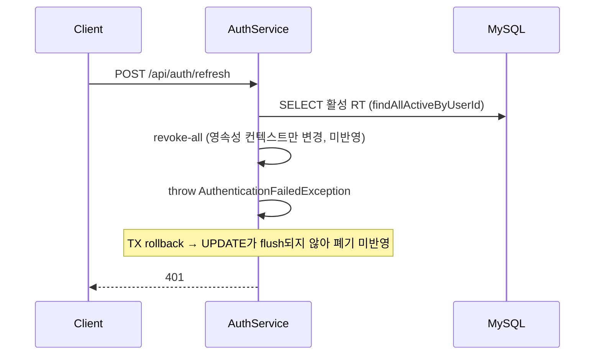
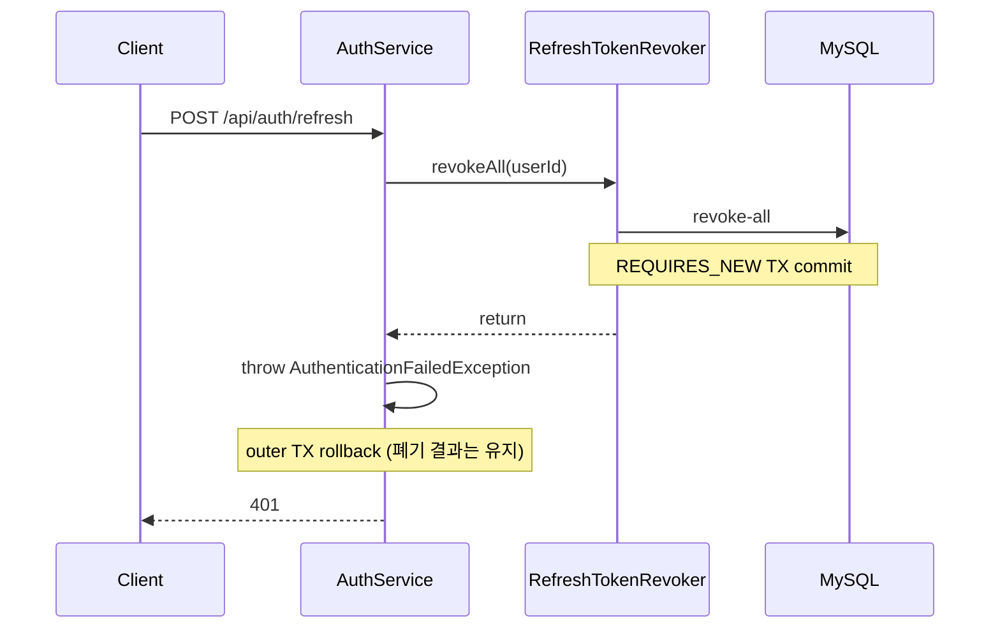

# 폐기된 Refresh Token 재사용 시 롤백되던 전체 로그아웃: revoke-all 트랜잭션 분리

> 관련 문서: [임시 식별자에서 토큰 탈취 대응까지: 인증 구조 4단계 진화](auth-evolution.md)

## 요약

- **[문제]** 폐기 토큰 재사용(탈취 신호) 시 **전체 로그아웃**이 인증 실패와 같은 트랜잭션이라 롤백됨
- **[해결]** 전체 로그아웃만 **REQUIRES_NEW**로 먼저 커밋해 통합 테스트로 검증
- **[결과]** prod 재현에서 폐기 토큰 재사용 시 누적된 **활성 Refresh Token 14개 → 0개**로 전체 기기 로그아웃 확인

## 1. 발견 경위

FlowMate는 refresh가 성공할 때마다 기존 Refresh Token(이하 RT)을 폐기하고 새 RT를 발급한다(RTR, Refresh Token Rotation). 그래서 이미 폐기된 RT가 다시 들어오면 탈취된 토큰의 재사용으로 보고, 같은 사용자의 활성 RT를 전부 폐기한다(재사용 탐지, Reuse Detection). 이 문서는 이 조치를 revoke-all이라 부르며, 사용자 입장에서는 그 계정의 모든 기기가 로그아웃되는 전체 로그아웃이다. 활성 RT는 폐기되지도 만료되지도 않은 RT를 말한다.

RT를 Redis로 옮길 근거를 모으려고 prod에서 인증 문제를 재현했다. 정상 사용자의 늦은 요청이 재사용 탐지에 걸려 강제 로그아웃되는 오탐을 확인하려던 것이었는데, 폐기된 RT로 refresh를 보내자 401만 돌아오고 같은 사용자의 활성 RT 16개는 그대로였다. 오탐이 아니라 재사용 탐지 자체가 동작하지 않고 있었다.

폐기된 RT로 보낸 요청은 401로 막혔지만 revoke-all이 DB에 반영되지 않아 같은 사용자의 활성 RT가 모두 남았다. 탈취자가 먼저 회전에 성공해 새 RT를 쥐고 있었다면 그 RT도 살아남으므로, 탈취 대응이 없는 것과 같았다.

## 2. 원인: revoke-all이 같은 트랜잭션에서 롤백됨

수정 전 `refresh()` 메서드의 Reuse Detection 경로는 다음과 같았다.

```java
@Transactional
public LoginResponse refresh(...) {
    // ...
    if (!refreshToken.isValid()) {
        if (refreshToken.isStolenReuse()) {
            refreshTokenRepository.findAllActiveByUserId(refreshToken.getUserId(), Instant.now())
                    .forEach(RefreshToken::revoke);
        }
        throw new AuthenticationFailedException("만료 또는 폐기된 Refresh Token");
    }
    // ...
}
```

코드만 보면 폐기된 RT가 재사용됐을 때 같은 사용자의 활성 RT 전체를 폐기하는 것처럼 보인다. 문제는 revoke-all에 따른 DB 상태 변경이
`refresh()`를 감싸는 트랜잭션 안에서 처리된 뒤, 곧바로
`AuthenticationFailedException`이 발생한다는 점이었다.

`AuthenticationFailedException`은
`RuntimeException`을 상속하는 unchecked exception이며, Spring의 선언적 트랜잭션은 기본적으로 unchecked exception 발생 시 현재 트랜잭션을 롤백한다.

`forEach(RefreshToken::revoke)`는 영속성 컨텍스트의 엔티티만 변경한다. 이 변경은 커밋 직전 flush에서야 UPDATE로 나갈 예정이었는데, 예외로 `refresh()` 트랜잭션이 커밋 대신 롤백되면서 flush 없이 버려졌다. UPDATE는 DB에 한 번도 실행되지 않았다.

### 단위 테스트에서 놓친 이유

단위 테스트는 mock repository가 반환한 엔티티의 메모리 상태만 확인한다. 따라서
`revoke()`가 호출됐는지는 검증할 수 있지만, 예외 발생 후 트랜잭션이 롤백될 때 DB row에 실제로 반영되는지까지는 확인할 수 없다.

즉, 이번 버그는 비즈니스 분기가 아니라 트랜잭션 경계의 문제였기 때문에 단위 테스트만으로는 구조적으로 잡기 어려웠다.

## 3. 대안과 선택

이번 문제의 핵심은 revoke-all이 실행되지 않은 것이 아니라, revoke-all에 따른 DB 상태 변경이 예외와 함께 같은 트랜잭션에서 롤백됐다는 점이었다. 따라서 해결 조건은 인증 실패로 `refresh()`가 롤백되더라도 revoke-all의 결과만은 커밋되게 하는 것이었다.

| 대안 | 방식 | 판단 |
|----|----|----|
| (a) | `refresh()`에 `@Transactional(noRollbackFor = AuthenticationFailedException.class)` | 기각 |
| (b) | revoke-all만 별도 트랜잭션(`REQUIRES_NEW`)으로 분리 | **선택** |
| (c) | Redis 마커(`revoked:{hash}`) 기반으로 Reuse Detection 재설계 | 보류 |

(a)는 `AuthenticationFailedException`이 발생해도 outer 트랜잭션 전체를 커밋하게 만든다. 그러면 revoke-all뿐 아니라 앞으로 `refresh()`에 생길 모든 쓰기까지 인증 실패에도 커밋 대상이 된다. (b)는 인증 실패에 따른 outer 트랜잭션 롤백은 그대로 두고, 커밋 보장을 revoke-all에만 둔다. 다만 `REQUIRES_NEW`는 revoke-all이 끝날 때까지 outer 트랜잭션을 일시 중단하고 DB 커넥션을 하나 더 사용한다. 이 비용은 폐기 RT 재사용으로 판정된 요청에서만 생긴다.

(c)는 DB 트랜잭션 롤백의 영향은 받지 않지만 RT 저장소를 Redis로 옮기는 재설계라 보류했고, 이후 RT 정본은 MySQL에 두기로 정했다.

(b)를 고르면 하나를 더 챙겨야 한다. `@Transactional`은 Spring AOP proxy를 통해 적용된다. 같은 클래스 내부에서
`REQUIRES_NEW`가 붙은 메서드를 직접 호출하는 self-invocation(자기 호출) 구조에서는 proxy를 거치지 않기 때문에 새 트랜잭션이 시작되지 않는다.

결론적으로, 해결 방향은 다음과 같이 정리했다.

- `AuthenticationFailedException`에 의한 outer 트랜잭션 롤백은 그대로 둔다.
- 롤백되면 안 되는 revoke-all의 DB 상태 변경은 `REQUIRES_NEW` 트랜잭션으로 분리한다.
- `REQUIRES_NEW`가 실제 적용되도록 revoke-all 메서드를 별도 Bean으로 분리해 Spring proxy를 거치게 한다.

## 4. 해결: revoke-all을 독립 트랜잭션으로 분리

revoke-all을 담당하는 별도 Bean을 만들고, 해당 메서드에 `REQUIRES_NEW` 트랜잭션을 적용했다.

```java
@Service
@RequiredArgsConstructor
public class RefreshTokenRevoker {

    private final RefreshTokenRepository refreshTokenRepository;

    @Transactional(propagation = Propagation.REQUIRES_NEW)
    public void revokeAll(String userId) {
        refreshTokenRepository.revokeAllActiveByUserId(userId, Instant.now());
    }
}
```

같은 변경에서 revoke-all을 JPQL UPDATE 한 문장으로 바꿨지만, 롤백 문제를 푼 것은 이것이 아니라 트랜잭션 분리다.

`AuthService.refresh()`는 폐기된 RT 재사용이 감지되면 revoke-all을 `RefreshTokenRevoker`에 위임한다.

```java
if (!refreshToken.isValid()) {
    if (refreshToken.isStolenReuse()) {
        refreshTokenRevoker.revokeAll(refreshToken.getUserId());
    }
    throw new AuthenticationFailedException("만료 또는 폐기된 Refresh Token");
}
```

결과적으로 `RefreshTokenRevoker`의 `REQUIRES_NEW` 트랜잭션이 먼저 커밋된다. 이후 `AuthService.refresh()`에서
`AuthenticationFailedException`이 발생해 outer 트랜잭션이 롤백되더라도, 이미 커밋된 revoke-all 결과는 유지된다.

### 트랜잭션 경계: Before / After

#### Before: revoke-all이 outer TX에 묶인 상태 (폐기된 RT 재사용 경로만 표현)



#### After: revoke-all을 REQUIRES_NEW로 분리 (폐기된 RT 재사용 경로만 표현)



## 5. 검증

### 5.1 통합 테스트(H2)

`AuthServiceIT`는 Spring Context, 트랜잭션 프록시, JPA repository, H2 DB를 사용해 예외 발생 이후의 DB 상태를 직접 조회한다. 이번 문제는 단순히 메서드 호출 여부가 아니라 트랜잭션 커밋 여부가 핵심이었기 때문에, 실제 Spring 트랜잭션 경계 안에서 검증할 필요가 있었다.

| 의미     | 테스트                                                             | 검증 내용                                         |
|--------|-----------------------------------------------------------------|-----------------------------------------------|
| 정상 회전  | `refresh_validToken_rotatesOnlyCurrentToken`                    | 정상 refresh는 현재 RT만 폐기하고, 같은 사용자의 다른 활성 RT는 유지 |
| 단순 만료  | `refresh_expiredToken_doesNotRevokeOtherActiveTokens`           | 만료됐지만 폐기되지 않은 RT는 reuse 신호로 보지 않음             |
| 재사용 탐지 | `refresh_reusedRevokedToken_commitsRevokeAllDespiteAuthFailure` | 인증 실패 이후에도 같은 사용자의 활성 RT가 폐기됨, 다른 사용자 RT는 유지 |

- `RefreshTokenRevoker.revokeAll()`의 전파 속성을 기본 전파(`REQUIRED`)로 임시 변경한 뒤
  `refresh_reusedRevokedToken_commitsRevokeAllDespiteAuthFailure`를 실행해 버그가 실제로 재현되는지 확인했다. 이때 활성 RT의 `revoked_at`이
  `null`로 남으며 테스트가 실패했다 (Red).
- `REQUIRES_NEW`를 복구하자 같은 테스트가 통과했고, 예외 발생 이후에도 revoke-all 결과가 DB에 커밋되는 것을 확인했다 (Green).

### 5.2 prod 재현

v1.12.2 배포 후, 실제 기기로 재사용 시나리오를 재현해 fix가 prod에서도 동작하는지 확인했다. 데스크톱과 모바일로 같은 계정에 로그인해 기기별 활성 RT chain을 만들었다. 이후 DB에서 데스크톱의 최신 활성 RT row 하나만
`revoked_at = NOW()`로 수동 세팅하여, 폐기된 RT가 다시 전송되는 상황을 재현했다. 데스크톱 브라우저 콘솔에서 refresh를 호출하자 401이 돌아왔다.

```text
POST https://api.flowmate.io.kr/api/auth/refresh 401 (Unauthorized)
{"error":{"code":"AUTHENTICATION_FAILED","message":"만료 또는 폐기된 Refresh Token","fields":null}}
```

| 항목                            | 결과                                 |
|-------------------------------|------------------------------------|
| 같은 사용자의 활성 RT (재사용 요청 전 → 후) | 14개 → **0개**                        |
| 다른 기기(모바일)                    | 다음 refresh에서 401을 받아 로그아웃, 재로그인하면 새 활성 RT 1개만 생성 |

다른 기기는 RT가 폐기된 즉시가 아니라 다음 refresh에서 로그아웃된다. Access Token은 서명만 검증하는 JWT(TTL 15분)라, 폐기된 RT로 refresh를 호출할 때 비로소 401을 받기 때문이다.

14개는 login마다 새 chain이 생기고, logout 없이 버려진 chain의 마지막 RT가 14일 동안 남아 쌓인 것이다.

## 6. 후속: revoke-all 인덱스

revoke-all을 고친 뒤, revoke-all UPDATE가 쓰는 인덱스도 추가했다.

RTR 환경에서는 login과 refresh가 반복될수록 사용자별 Refresh Token 이력이 누적될 수 있고, Reuse Detection이 발생하면 해당 사용자의 모든 활성 RT를 폐기해야 한다.

```sql
UPDATE auth_refresh_tokens
SET revoked_at = :now
WHERE user_id = :userId
  AND revoked_at IS NULL
  AND expires_at > :now;
```

초기에는 이 조회에 쓸 수 있는 인덱스가 FK 보조 인덱스 `fk_refresh_user(user_id)`뿐이었다.

이 인덱스를 사용하면 특정 사용자의 RT 이력은 빠르게 찾을 수 있지만, `revoked_at IS NULL`과
`expires_at > :now` 조건은 인덱스에서 충분히 좁히지 못하고 이후 filter로 처리된다.

즉, 한 사용자에게 RT 이력이 많이 누적된 경우 실제로 폐기할 토큰이 일부이더라도 **해당 사용자의 전체 RT 이력을 먼저 읽어야 하는 문제가 있다.**

이를 개선하기 위해 Flyway V7에서 다음과 같은 복합 인덱스를 추가했다.

```sql
CREATE INDEX idx_refresh_tokens_active_by_user
    ON auth_refresh_tokens (user_id, revoked_at, expires_at);
```

인덱스 컬럼 순서는 조회 조건에 맞춰 구성했다.

- `user_id = :userId`: 동등 조건
- `revoked_at IS NULL`: 하나의 값(NULL)으로 좁히므로 인덱스에서 동등 조건처럼 쓰인다
- `expires_at > :now`: 범위 조건

동등 조건을 앞에 두고 범위 조건인 expires_at을 마지막에 배치하면, 특정 사용자의 전체 RT 이력을 조회한 뒤 filter하는 대신 **활성 RT 범위를 인덱스 단계에서 바로 좁힐 수 있다.**

### 실행 계획 비교

같은 `WHERE` 절을 사용하는 `SELECT id`로 MySQL 8.0.46 `EXPLAIN ANALYZE`를 측정했다 (데이터 변경 없이 접근 행 수만 비교하기 위해서다). UPDATE는 covering scan이 될 수 없으므로 아래 실행 시간을 UPDATE에 그대로 옮겨 읽지 않는다.

테스트 데이터는 한 사용자의 RT 100,000건으로 구성했다.

- 폐기 토큰: 99,000건
- 활성 토큰: 1,000건

| 구분     | 실행 계획                             | 인덱스에서 읽은 행 |  반환 행 |   총 실행 시간 |
|--------|-----------------------------------|-----------:|------:|----------:|
| Before | `fk_refresh_user` lookup 후 filter |    100,000 | 1,000 |   약 137ms |
| After  | 복합 인덱스 covering range scan        |      1,000 | 1,000 | 약 0.929ms |

Before 계획에서는 fk_refresh_user를 이용해 해당 사용자의 RT 100,000건을 먼저 찾은 뒤, revoked_at과 expires_at 조건으로 1,000건을 filter했다.

반면 After 계획에서는 `user_id = ? AND revoked_at IS NULL AND expires_at > NOW()` 범위로 복합 인덱스를 읽었다.
`SELECT id`는 secondary index에 포함된 PK를 함께 읽을 수 있어 covering scan으로 처리됐다.

결과적으로 인덱스에서 읽는 행 수가 **100,000건에서 1,000건으로 감소**했다. 이 수치는 로컬 MySQL의 합성 데이터 기준이며, 운영 SLA로 해석하지 않는다.

대신 `revoked_at`이 인덱스에 들어가, 모든 refresh의 폐기 UPDATE와 새 RT INSERT가 이 인덱스도 갱신한다. 이 쓰기 비용은 측정하지 않았다.

## 7. 한계

- **오탐으로 보이는 전체 로그아웃이 있었다.** 수정 후 prod에서 두 기기가 몇 분 간격으로 refresh 401을 받아 계정 전체가 로그아웃된 사례가 있었다. 늦게 도착한 정상 refresh가 재사용으로 판정된 것으로 보지만 원인은 확정하지 못했다. 프론트가 refresh 실패 뒤 logout을 자동 호출하던 경로는 없앴지만, 백엔드에는 유예 구간 같은 오탐 완화가 아직 없다.
- **Access Token은 끊지 못한다.** revoke-all은 RT만 폐기하므로, 이미 발급된 Access Token은 최대 15분 동안 유효하다.
- **동시 refresh 경합은 그대로다.** `refresh()`는 SELECT 후 UPDATE 구조라 같은 RT로 동시에 들어온 두 요청이 모두 통과해 RT를 두 개 발급할 수 있다.
- **후속 작업은 [#33](https://github.com/g1ennk/FlowMate/issues/33)에서 추적한다.** 조건부 UPDATE로 RT를 한 번만 소비하고, 동시 경쟁에서 진 요청은 revoke-all 대신 `409`로 돌려보내 오탐과 이중 발급을 함께 줄이는 안이다.

## 8. 회고

### 반드시 커밋돼야 하는 쓰기는 DB 상태로 확인해야 한다

Reuse Detection 분기 자체는 처음부터 의도대로 작성돼 있었다. 문제는 분기 조건이 아니라, 실패 응답 경로에서 수행한 revoke-all이 같은 트랜잭션에 묶여 있었다는 점이었다. 실패 응답을 반환하는 흐름에도 반드시 커밋돼야 하는 쓰기가 있을 수 있고, 그런 작업을 예외와 함께 롤백되는 트랜잭션에 두면 코드가 실행돼도 DB에는 남지 않는다.

mock 기반 단위 테스트로는 이를 볼 수 없어 prod 재현에서야 발견했다. 그래서 `AuthServiceIT`로 실제 트랜잭션 경계에서 DB 상태를 확인하는 회귀 테스트를 남겼다. 해결 과정에서 `@Transactional`이 AOP proxy 기반이라 self-invocation에는 적용되지 않는다는 점도 새로 알게 됐다.

### 동작하지 않던 탐지는 오탐도 가린다

수정 전에는 롤백이 탈취 대응과 함께, 있었을지 모를 오탐까지 지우고 있었다. revoke-all이 실제로 커밋된 뒤 계정 전체 로그아웃이 일어났고, 늦게 도착한 정상 refresh의 오탐으로 의심하지만 원인은 확정하지 못했다(7절). 탐지를 되살릴 때는 정상 사용자의 늦은 요청을 어떻게 구분할지도 같이 정해야 한다는 것을 배웠다.
