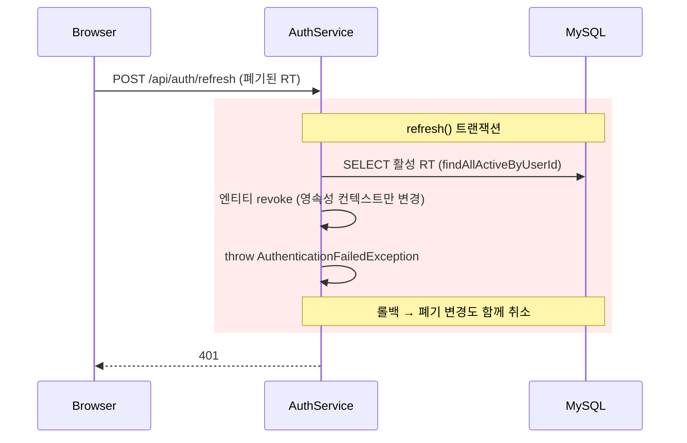
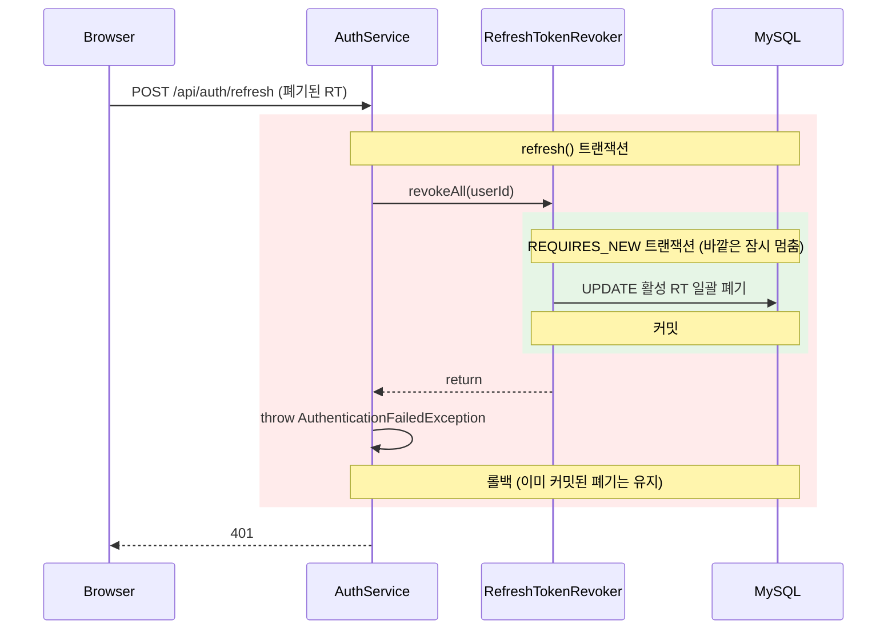

# 폐기된 Refresh Token 재사용 시 롤백되던 전체 로그아웃: revoke-all 트랜잭션 분리

> 관련 문서: [임시 식별자에서 토큰 탈취 대응까지: 인증 구조 4단계 진화](auth-evolution.md)

## 요약

- **[문제]** 폐기 토큰 재사용(탈취 신호) 시 **전체 로그아웃**이 인증 실패와 같은 트랜잭션이라 롤백됨
- **[해결]** 전체 로그아웃만 별도 Bean의 **REQUIRES_NEW** 트랜잭션으로 먼저 커밋하고, 통합 테스트로 검증
- **[결과]** prod 재현에서 폐기 토큰 재사용 시 누적된 **활성 Refresh Token 14개 → 0개**로 전체 기기 로그아웃 확인

## 1. 문제 배경

FlowMate는 refresh가 성공할 때마다 기존 Refresh Token(이하 RT)을 폐기하고 새 RT를 발급한다(RTR, Refresh Token Rotation). 그래서 이미 폐기된 RT가 다시 들어오면 탈취된 토큰의 재사용으로 보고, 같은 사용자의 활성 RT(폐기되지도 만료되지도 않은 RT)를 전부 폐기한다(재사용 탐지, Reuse Detection). 이 문서는 이 조치를 revoke-all이라 부르며, 사용자 입장에서는 그 계정의 모든 기기가 로그아웃되는 전체 로그아웃이다.

### prod 재현에서 발견

RT를 Redis로 옮길 근거를 모으려고 prod에서 인증 문제를 재현했다. 정상 사용자의 늦은 요청이 재사용 탐지에 걸려 강제 로그아웃되는 오탐을 확인하려던 것이었는데, 폐기된 RT로 refresh를 보내자 401만 돌아오고 같은 사용자의 활성 RT 16개는 그대로였다. 오탐이 아니라 재사용 탐지 자체가 동작하지 않고 있었다.

401 응답은 나가니 겉으로는 정상처럼 보였다. 하지만 탈취자가 먼저 회전에 성공해 새 RT를 쥐고 있었다면 그 RT도 살아남으므로, 탈취 대응이 없는 것과 같았다.

## 2. 원인: revoke-all이 같은 트랜잭션에서 롤백됨

수정 전 `refresh()` 메서드의 Reuse Detection 경로는 다음과 같았다.

```java
@Transactional
public LoginResponse refresh(...) {
    // ...
    if (!refreshToken.isValid()) {
        if (refreshToken.isStolenReuse()) {
            refreshTokenRepository.findAllActiveByUserId(refreshToken.getUserId(), Instant.now())
                    .forEach(RefreshToken::revoke);
        }
        throw new AuthenticationFailedException("만료 또는 폐기된 Refresh Token");
    }
    // ...
}
```

코드만 보면 폐기된 RT(`isStolenReuse()`는 `revokedAt != null`로 판정)가 재사용됐을 때 같은 사용자의 활성 RT 전체를 폐기하는 것처럼 보인다. 문제는 revoke-all의 변경이 아직 DB에 나가지 않고 `refresh()` 트랜잭션 안에 머문 채, 곧바로 `AuthenticationFailedException`이 발생한다는 점이었다.

`AuthenticationFailedException`은 `RuntimeException`을 상속하는 unchecked exception이며, Spring의 선언적 트랜잭션은 기본적으로 unchecked exception 발생 시 현재 트랜잭션을 롤백한다.

`forEach(RefreshToken::revoke)`는 영속성 컨텍스트의 엔티티만 변경한다. 이 변경은 커밋 직전 flush에서야 UPDATE로 나갈 예정이었는데, 예외로 `refresh()` 트랜잭션이 커밋 대신 롤백되면서 flush 없이 버려졌다. UPDATE를 먼저 flush했더라도 같은 트랜잭션이라 롤백으로 되돌려졌을 것이다.

### 단위 테스트에서 놓친 이유

단위 테스트는 mock repository가 반환한 엔티티의 메모리 상태만 확인한다. 따라서 `revoke()`가 호출됐는지는 검증할 수 있지만, 예외 발생 후 트랜잭션이 롤백될 때 DB row에 실제로 반영되는지까지는 확인할 수 없다.

이번 버그는 분기 로직이 아니라 트랜잭션 경계의 문제라, 단위 테스트만으로는 구조적으로 잡기 어려웠다.

## 3. 대안과 선택: 왜 REQUIRES_NEW인가

예외가 나도 쓰기를 남기는 방법은 무엇을 남겨야 하는지에 따라 맞는 방식이 다르다. 여기서는 실패한 refresh의 롤백은 그대로 두고, revoke-all 결과만 커밋돼야 했다.

| 방식 | 맞는 경우 (예시) | 이 문제에 쓰면 | 판단 |
|---|---|---|---|
| `noRollbackFor` | 특정 예외가 나도 메서드의 쓰기를 전부 남겨야 할 때 (실패 이력만 기록하고 끝나는 메서드) | 지금은 동작하지만, 인증 실패에도 커밋된다는 규칙이 메서드 전체에 걸려 어떤 쓰기가 남는지 코드에서 드러나지 않음 | 부적합 |
| Redis 마커 (`revoked:{hash}`) | RT를 이미 Redis에 두고 있을 때 | DB 롤백과 무관하지만, 트랜잭션 버그 하나를 고치려고 RT 저장소를 옮기는 재설계 | 과잉 (재현 결과 MySQL 안에서 고칠 수 있어 RT는 MySQL에 두기로 결정) |
| **`REQUIRES_NEW` 분리** | **실패해도 일부 쓰기만은 남겨야 할 때** (감사 로그, 로그인 실패 횟수 기록) | 실패한 refresh의 롤백은 그대로 두고 revoke-all만 먼저 커밋. 재사용으로 판정된 요청에서만 outer 트랜잭션을 잠시 멈추고 DB 커넥션을 하나 더 씀 | **채택** |

`REQUIRES_NEW`를 고르면 하나를 더 챙겨야 한다. `@Transactional`은 Spring AOP proxy를 통해 적용된다. 같은 클래스 내부에서 `REQUIRES_NEW`가 붙은 메서드를 직접 호출하는 self-invocation(자기 호출) 구조에서는 proxy를 거치지 않기 때문에 새 트랜잭션이 시작되지 않는다.

그래서 해결 방향을 다음과 같이 정했다.

- `AuthenticationFailedException`에 의한 outer 트랜잭션 롤백은 그대로 둔다.
- 롤백되면 안 되는 revoke-all의 DB 상태 변경은 `REQUIRES_NEW` 트랜잭션으로 분리한다.
- `REQUIRES_NEW`가 실제 적용되도록 revoke-all 메서드를 별도 Bean으로 분리해 Spring proxy를 거치게 한다.

## 4. 해결: revoke-all을 독립 트랜잭션으로 분리

revoke-all을 담당하는 별도 Bean을 만들고, 해당 메서드에 `REQUIRES_NEW` 트랜잭션을 적용했다.

```java
@Service
@RequiredArgsConstructor
public class RefreshTokenRevoker {

    private final RefreshTokenRepository refreshTokenRepository;

    @Transactional(propagation = Propagation.REQUIRES_NEW)
    public void revokeAll(String userId) {
        refreshTokenRepository.revokeAllActiveByUserId(userId, Instant.now());
    }
}
```

같은 변경에서 revoke-all을 JPQL UPDATE 한 문장으로 바꿨지만, 롤백 문제를 푼 것은 이것이 아니라 트랜잭션 분리다.

`AuthService.refresh()`는 폐기된 RT 재사용이 감지되면 revoke-all을 `RefreshTokenRevoker`에 위임한다.

```java
if (!refreshToken.isValid()) {
    if (refreshToken.isStolenReuse()) {
        refreshTokenRevoker.revokeAll(refreshToken.getUserId());
    }
    throw new AuthenticationFailedException("만료 또는 폐기된 Refresh Token");
}
```

그래서 `RefreshTokenRevoker`의 `REQUIRES_NEW` 트랜잭션이 먼저 커밋된다. 이후 `AuthService.refresh()`에서 `AuthenticationFailedException`이 발생해 outer 트랜잭션이 롤백되더라도, 이미 커밋된 revoke-all 결과는 유지된다.

### 트랜잭션 경계: Before / After

두 그림 모두 폐기된 RT 재사용 경로만 그렸다.

#### Before: revoke-all이 바깥 트랜잭션에 묶임



#### After: revoke-all만 REQUIRES_NEW로 분리



## 5. 검증

### 5.1 통합 테스트(H2)

`AuthServiceIT`는 실제 Spring 트랜잭션과 H2 DB로 `refresh()`를 실행하고, 예외가 난 뒤 DB 상태를 다시 조회한다. 테스트에는 `@Transactional`을 붙이지 않아, 서비스의 트랜잭션이 테스트에 합류하지 않고 그대로 커밋되거나 롤백된다.

| 경우     | 테스트                                                             | 검증 내용                                         |
|--------|-----------------------------------------------------------------|-----------------------------------------------|
| 정상 회전  | `refresh_validToken_rotatesOnlyCurrentToken`                    | 정상 refresh는 현재 RT만 폐기하고, 같은 사용자의 다른 활성 RT는 유지 |
| 단순 만료  | `refresh_expiredToken_doesNotRevokeOtherActiveTokens`           | 만료됐지만 폐기되지 않은 RT는 재사용 신호로 보지 않음             |
| 재사용 탐지 | `refresh_reusedRevokedToken_commitsRevokeAllDespiteAuthFailure` | 인증 실패 이후에도 같은 사용자의 활성 RT가 폐기됨, 다른 사용자 RT는 유지 |

- `RefreshTokenRevoker.revokeAll()`의 전파 속성을 기본 전파(`REQUIRED`)로 임시 변경한 뒤 `refresh_reusedRevokedToken_commitsRevokeAllDespiteAuthFailure`를 실행해 버그가 실제로 재현되는지 확인했다. 이때 활성 RT의 `revoked_at`이 `null`로 남으며 테스트가 실패했다 (Red).
- `REQUIRES_NEW`를 복구하자 같은 테스트가 통과했고, 예외 발생 이후에도 revoke-all 결과가 DB에 커밋되는 것을 확인했다 (Green).

### 5.2 prod 재현

v1.12.2 배포 후, 실제 기기로 재사용 시나리오를 재현해 수정이 prod에서도 동작하는지 확인했다. 데스크톱과 모바일로 같은 계정에 로그인해 기기별 활성 RT chain을 만들었다. 이후 DB에서 데스크톱의 최신 활성 RT row 하나만 `revoked_at = NOW()`로 직접 바꿔, 폐기된 RT가 다시 전송되는 상황을 만들었다. 데스크톱 브라우저 콘솔에서 refresh를 호출하자 401이 돌아왔다.

```text
POST https://api.flowmate.io.kr/api/auth/refresh 401 (Unauthorized)
{"error":{"code":"AUTHENTICATION_FAILED","message":"만료 또는 폐기된 Refresh Token","fields":null}}
```

| 항목                            | 결과                                 |
|-------------------------------|------------------------------------|
| 같은 사용자의 활성 RT (재사용 요청 전 → 후) | 14개 → **0개**                        |
| 다른 기기(모바일)                    | 다음 refresh에서 401을 받아 로그아웃, 재로그인하면 새 활성 RT 1개만 생성 |

다른 기기는 RT가 폐기된 즉시가 아니라 다음 refresh에서 로그아웃된다. Access Token은 서명만 검증하는 JWT(TTL 15분)라, 폐기된 RT로 refresh를 호출할 때 비로소 401을 받기 때문이다.

14개는 로그인마다 새 chain이 생기고, 로그아웃 없이 버려진 chain의 마지막 RT가 14일 동안 남아 쌓인 것이다. 1절의 16개와 다른 것도 시점마다 남아 있던 chain 수가 달라서다.

## 6. 한계

- **정상 refresh가 재사용으로 오판될 수 있다.** revoke-all이 실제로 동작하면서, 오판 한 번이 계정 전체 로그아웃으로 이어진다. 수정 후 prod에서 두 기기가 몇 분 간격으로 refresh 401을 받아 계정 전체가 로그아웃된 사례가 있었다. 같은 RT로 거의 동시에 들어온 refresh 중 늦은 쪽이 재사용으로 판정된 것으로 보지만 원인은 확정하지 못했다. RT를 조건부 UPDATE로 한 번만 소비하고, 경쟁에서 진 요청은 revoke-all 대신 `409`로 돌려보내는 안을 [#33](https://github.com/g1ennk/FlowMate/issues/33)에서 추적한다.

## 7. 회고

### 탐지를 고치자 오판의 피해가 드러났다

수정 전에는 revoke-all이 매번 롤백돼, 정상 요청이 재사용으로 잘못 판정돼도 그 요청 하나만 401을 받고 끝났다. 수정 후에는 같은 오판이 계정 전체 로그아웃으로 이어졌고, 실제로 그런 사례가 생겼다(6절). 탐지를 고쳐 다시 켤 때는 잘못 판정했을 때 무슨 일이 생기는지와, 정상 요청을 어떻게 구분할지도 함께 정해야 한다는 것을 배웠다.
