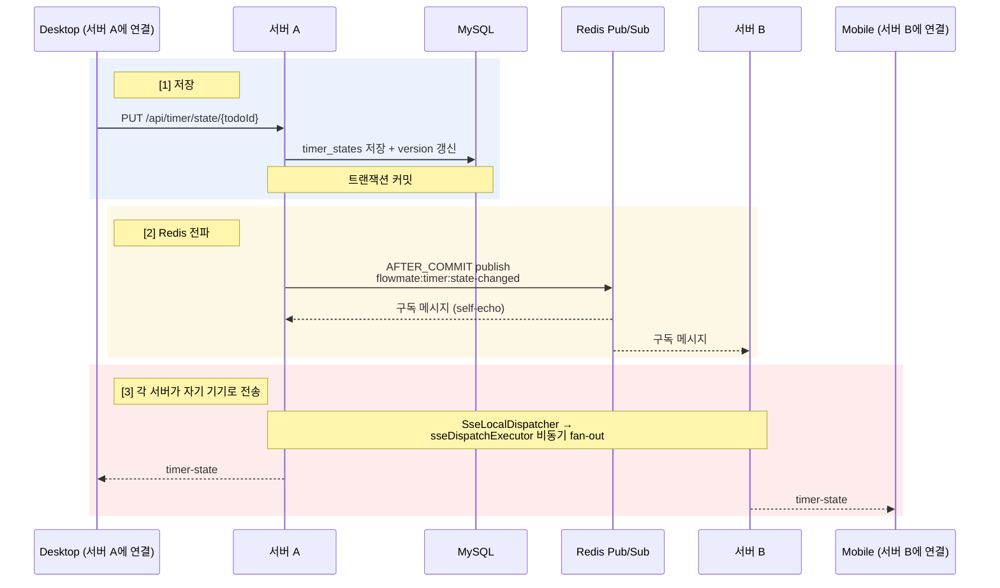

# Redis Pub/Sub으로 SSE 수평 확장하기

> 선행 문서: [SSE 멀티디바이스 타이머 동기화: 단방향 push와 version 기반 순서 보장](sse-sync.md)
>
> 관련 문서: [Self-hosted 모니터링을 Alloy + Grafana Cloud로 전환하기](monitoring-stack.md)

## 요약

- **[문제]** SSE 연결을 서버 메모리에 보관해, 서버를 2대 이상으로 늘리면 **다른 서버에 연결된 기기에는 변경이 전달되지 않음**
- **[해결]** 커밋 후 변경을 **Redis Pub/Sub**으로 발행하고 각 서버가 구독해 자기 기기에 전송. 상태는 MySQL에 남아 있어 메시지를 보관하지 않는 Pub/Sub으로 충분
- **[결과]** 다른 서버에 연결된 기기 **도달률 0→100%**(로컬 서버 2대), 부하 **30,000건 유실 0건**, dev EC2 배포 후 Redis 채널로 발행 확인

## 1. 문제 배경: 단일 JVM broadcast의 한계

Redis 도입 전에는 `TimerService`가 상태를 저장한 뒤 `SseEmitterRegistry.broadcast()`를 직접 불렀다. `SseEmitterRegistry`는 사용자별 SSE 연결을 서버 메모리에 보관하므로, 이벤트는 그 서버에 연결된 기기에만 닿는다. 서버가 한 대일 때는 문제가 없지만, 서버를 늘리면 각 서버는 자기에게 연결된 기기만 안다.

예를 들어 서버를 2대로 늘리면 다음과 같은 상황이 발생한다.

```text
PUT /api/timer/state/{todoId} ──► 서버 A
                          │ SseEmitterRegistry.broadcast(userId)
                          ▼
              서버 A에 연결된 기기만 수신 ✅
              서버 B에 연결된 기기는 수신 불가 ❌
```

같은 사용자가 PC는 서버 A에, 모바일은 서버 B에 연결했다면, PC에서 타이머를 바꿔도 모바일에는 전달되지 않는다.

prod는 서버 1대다. 그래도 먼저 고친 이유는 다음 단계가 서버 증설이었기 때문이다. 이전 dev 부하 측정에서 커넥션 풀이나 쿼리보다 호스트 CPU가 먼저 한계에 닿았고([모니터링 위키](monitoring-stack.md)), 서버를 늘리는 순간 이 결함이 타이머 동기화를 깬다.

## 2. 대안과 선택: 왜 Redis Pub/Sub인가

서버 간 메시지 전달도 메시지를 놓쳤을 때 다시 받아야 하는지에 따라 맞는 방식이 다르다.

| 유형 | 예시 | 적합한 방식 |
|---|---|---|
| 놓치면 안 되고, 나중에 다시 읽어 처리해야 함 | 주문, 결제 이벤트, 로그 수집 | Kafka |
| 놓치면 안 되지만 Kafka까지는 과한 규모 | 작업 큐, 알림 발송 대기열 | Redis Streams |
| **지금 알리기만 하면 되고, 원본은 따로 있음** | 채팅 접속 상태, 캐시 무효화 알림 | **Redis Pub/Sub** |

타이머 이벤트는 세 번째 유형이었다. 판단 기준은 두 가지였다. 메시지를 보관했다가 다시 줄 필요(영속성)가 있는가, 그리고 늘어나는 운영 부담이 문제 규모에 맞는가.

| 방식                             | 장점                                     | 단점                                                                 | 판단     |
|--------------------------------|----------------------------------------|--------------------------------------------------------------------|--------|
| Sticky Session (userId 해시 라우팅) | 브로커 없이 같은 사용자의 기기를 한 서버로 모을 수 있음        | 서버 장애나 rolling deploy 중에는 같은 사용자의 기기가 서로 다른 서버로 갈라져 다시 전파가 끊김 | 부적합    |
| Kafka                          | 메시지 보장, 파티션 내 순서 보장, replay 지원         | 현재 요구사항 대비 운영과 구성 복잡도가 높음                                          | 과잉     |
| Redis Streams                  | 소비자 그룹, ack, replay 지원                 | 소비자 그룹, ack, 메시지 정리를 직접 다뤄야 함                                         | 과잉     |
| DB Polling                     | 추가 인프라 불필요                             | 실시간성이 떨어지고 DB 부하가 증가할 수 있음                                         | 부적합    |
| **Redis Pub/Sub**              | 낮은 지연, 구현 단순, Spring Data Redis 연동 용이  | at-most-once: 발행 순간 구독하지 않은 서버는 메시지를 못 받음                                         | **채택** |

### Redis Pub/Sub을 선택한 이유

메시지를 보관할 필요가 없었다. 타이머 상태는 MySQL `timer_states`에 저장되고, Redis는 "바뀌었다"를 다른 서버에 알리는 역할만 한다. 메시지를 놓쳐도 상태는 MySQL에 남아 있어 데이터를 잃지는 않는다. 다만 놓친 기기가 상태를 다시 읽어 오는 경로(재연결 시 재조회)는 아직 없다(5절).

## 3. 아키텍처

Redis 도입 전에는 연결 등록부터 PUT, broadcast까지 서버 한 대 안에서 처리됐다(시퀀스는 [sse-sync 3절](sse-sync.md#3-아키텍처)). 도입 후에는 `PUT`을 받은 서버가 저장이 커밋된 뒤 이벤트를 Redis 채널에 발행(publish)한다. 이 채널을 구독하는 모든 서버가 메시지를 받아, 각자 자기에게 연결된 기기에 보낸다(fan-out).

발행은 `SseBroadcaster`, 구독과 전달은 `SseLocalDispatcher`, 실제 전송은 전용 executor(`sseDispatchExecutor`)가 맡는다.



발행한 서버 A도 같은 채널을 구독하므로 자기 메시지를 다시 받는다(서버 단위 self-echo). 일부러 이렇게 했다. 그러면 자기 기기에 보내는 경로와 다른 서버 기기에 보내는 경로가 "구독한 메시지를 받아 보낸다" 하나로 같아진다. 대신 Redis가 멈추면 같은 서버의 기기도 이벤트를 받지 못한다(5절).

발신 기기가 자기 이벤트를 다시 받는 것(기기 단위 self-echo)과 순서가 바뀌어 도착한 이벤트는 기기의 version 비교가 거른다([sse-sync 4.3절](sse-sync.md#43-늦게-온-이벤트는-기기가-거른다)).

### 핵심 설계 결정

핵심 트레이드오프는 메시지 보장보다 단순한 이벤트 전파를 우선한 것이다.

| 결정 | 이유 | 감수한 비용 |
|---|---|---|
| **도메인 이벤트로 분리** | `TimerService`는 "상태가 바뀌었다"는 이벤트만 발행하고 Redis와 SSE를 모른다. 그래서 저장 코드를 건드리지 않고 전파 방식만 바꿀 수 있었다 | - |
| **AFTER_COMMIT에 publish** | 커밋 전에 발행하면, 롤백돼 저장되지 않은 상태를 다른 기기가 받을 수 있다(유령 이벤트) | 커밋 뒤 발행이 실패하거나 그 사이 서버가 죽으면 그 이벤트는 다시 보내지 않는다(이벤트를 DB에 함께 저장해 두는 outbox 패턴 미적용) |
| **fan-out은 전용 executor에 위임** | Spring Data Redis의 메시지 리스너 컨테이너는 기본적으로 메시지마다 새 스레드를 만든다(`SimpleAsyncTaskExecutor`). 느린 기기가 몰리면 전송 스레드가 끝없이 늘 수 있어, 리스너는 메시지를 꺼내 작업을 넘기기만 하고 전송은 전용 executor가 맡는다. 스레드 4~8개, 대기 큐 200칸이다 | 스레드와 큐가 모두 차면 가장 오래된 전송을 버린다(`DiscardOldestPolicy`). 같은 사용자 이벤트의 전송 순서도 보장하지 않는다(기기의 version 비교가 거른다) |
| **전파 실패는 요청 처리와 분리** | 상태는 이미 DB에 저장됐으므로, 발행이나 개별 연결의 전송이 실패해도 예외를 삼켜 사용자의 PUT 응답과 다른 기기 전송을 막지 않는다 | Redis 장애 중에는 서버 1대에서도 실시간 동기화가 멈추고, PUT 응답이 최대 2초 늦어질 수 있다(5절) |

## 4. 검증

### 4.1 통합 테스트: Redis를 거쳐 로컬 fan-out까지 도달하는가

먼저 Redis에 발행한 이벤트가 구독자를 거쳐 `SseEmitterRegistry.broadcast()`까지 닿는지를 통합 테스트(`MultiInstanceSseIntegrationTest`)로 확인했다.

테스트 이름의 "인스턴스B"는 같은 Spring Context 안의 mock `SseEmitterRegistry`이고, 실제로 띄운 것은 Redis(`redis:7-alpine`, Testcontainers)뿐이다. 서로 다른 서버 프로세스 사이의 전달은 4.2, 4.3절에서 따로 확인했다.

테스트를 먼저 작성해, 구독자(`SseLocalDispatcher`)가 없을 때 실패하는 것을 확인한 뒤 구현해 통과시켰다.

커밋되면 발행하고 롤백되면 발행하지 않는지(`SseBroadcasterTest`), 발행 실패가 요청으로 번지지 않는지(`SseBroadcasterFailSilentTest`), 전송이 느려도 리스너가 바로 반환하는지(`SseLocalDispatcherTest`)도 테스트로 확인했다.

### 4.2 로컬 서버 2대(2-JVM) Before / After 측정

다음으로 로컬에서 서버 프로세스 2개(`8080`, `8081`)를 같은 MySQL에 붙여 띄웠다. 같은 사용자로 8080에만 `PUT`을 5번 보내고, 8081에 연결한 기기가 몇 건 받는지 셌다. Redis 도입 전(`main`)과 후(`feat/redis-sse-tdd`)를 같은 방식으로 쟀다.

| 측정 항목                          | Before (`main`) | After (`feat/redis-sse-tdd`) |
|--------------------------------|----------------:|-----------------------------:|
| 기기 A (8080 연결) 수신 |               5 |                            5 |
| 기기 B (8081 연결) 수신 |           **0** |                        **5** |
| **서버 간 도달률**                  |          **0%** |                     **100%** |
| Redis publish 메시지 수            |               0 |                            5 |

도입 전에는 이벤트가 8080 안에서만 돌아 8081의 기기는 한 건도 받지 못했고, 도입 후에는 Redis를 거쳐 5건 모두 받았다.

### 4.3 부하 측정

부하는 Node 스크립트로 걸었다(k6는 SSE 스트림을 이벤트 단위로 읽지 못한다). 사용자마다 SSE 연결 1개를 서버 B(`:8081`)에 열고, PUT은 서버 A(`:8080`)로만 보내 서버 간 경로만 쟀다. **유실**은 성공한 PUT 중 B에 도착하지 않은 건수, **지연**은 PUT 송신부터 B의 SSE 수신까지다.

| 단계 | 동시 연결 | 실제 송신(건/s) | 이벤트 수 | 도달률 | 유실 | p50 | p95 | p99 |
|---|---|---|---|---|---|---|---|---|
| 1 | 10 | 20 | 600 | **100%** | **0건** | 15ms | 20ms | 93ms |
| 2 | 50 | 97 | 3,000 | **100%** | **0건** | 6ms | 8ms | 11ms |
| 3 | 100 | 478 | 12,000 | **100%** | **0건** | 6ms | 10ms | 22ms |
| 4 | 200 | 918 | 30,000 | **100%** | **0건** | 11ms | 108ms | 244ms |

4단계에서 보낸 30,000건이 모두 B에 도착했다. 부하가 늘며 커진 것은 유실이 아니라 느린 소수의 지연이었다(2단계 p95 8ms → 4단계 108ms). 1단계가 2단계보다 느린 것은 서버가 막 떠서 예열(JVM 웜업) 중이었기 때문으로 본다.

다만 부하를 보내는 스크립트(드라이버)가 하나라 초당 약 920건 이상은 보내지 못했다. 4단계 목표는 초당 1,000건이었고, 목표를 3,000건으로 올린 추가 단계도 같은 속도에서 막혔다. 그래서 이 측정이 보여 주는 범위는 초당 약 920건까지다.

### 4.4 dev EC2 Redis 채널 확인

로컬 검증 뒤 dev EC2에 Redis를 배포했다. `redis-cli`로 채널을 직접 구독해 두고 브라우저에서 타이머를 조작해, 배포 환경에서도 발행한 이벤트가 Redis 채널에 닿는지 봤다. dev는 서버가 1대라 서버 간 전파를 확인한 것은 아니다(서버 간 전파는 4.2, 4.3절).

```text
$ docker exec flowmate-redis-dev redis-cli -a *** SUBSCRIBE flowmate:timer:state-changed

# 타이머 시작
{"userId":"8fbb...","todoId":"b705...","version":1782170915939,
 "state":"{...\"status\":\"running\"...}"}

# 일시정지
{"userId":"8fbb...","todoId":"b705...","version":1782170925205,
 "state":"{...\"status\":\"paused\"...}"}
```

캡처의 `version`은 당시 방식(현재 시각 ms)이라 큰 값이다. 지금은 1씩 오르는 순차 값이다.

`/actuator/health`에서 발행용과 구독용 Redis 연결이 모두 `UP`이었고(구독 중인 연결은 다른 명령을 보낼 수 없어 두 연결을 따로 둔다), Grafana Loki에서 발행 실패(`sse.publish.failed`)와 구독 쪽 처리 실패(`sse.dispatcher.exception`) 경고는 0건이었다.

## 5. 한계

- **놓친 이벤트를 자동으로 다시 받지 않는다.** Pub/Sub은 구독이 끊긴 동안의 메시지를 다시 주지 않고, executor가 포화되면 오래된 전송을 버린다. 기기는 SSE 재연결 때 상태를 다시 조회하지 않으므로, 다른 기기 화면은 그 Todo에 다음 이벤트가 오거나 앱을 다시 열 때까지 이전 상태일 수 있다. 상태 자체는 MySQL에 남는다.
- **Redis가 멈추면 같은 서버에 붙은 기기도 이벤트를 받지 못한다.** 같은 서버 기기로 가는 전송도 Redis를 거쳐 돌아오기 때문이다. `PUT`과 DB 저장은 성공하지만, 발행이 요청 스레드에서 Redis를 기다리므로 응답이 최대 2초(명령 timeout) 늦어진다. 서버 1대인 prod에 Redis 도입 전에 없던 의존이 생겼고, backend 기동에도 Redis가 필요하다.
- **부하 측정은 서버 2대, Redis, MySQL, 드라이버를 모두 한 머신에서 했고, executor 큐가 차는 지점까지 가지 못했다.** 이 결과는 "이 부하에서 유실이 없었다"이지 "큐 포화에서도 유실이 없다"가 아니다.

## 6. 회고

### 측정이 명분을 바꿨다

처음에는 DB 조회를 줄이려고 Redis를 캐시로 쓸 생각이었다. 그런데 직접 재 보니 단순 조회 요청은 서버에서 1~2ms로 이미 빨랐고, 서버가 버거웠던 진짜 이유는 CPU였다. 그래서 다음 단계는 캐시가 아니라 서버 증설이었고, 서버를 늘려도 동기화가 깨지지 않게 하는 데 Redis를 썼다. 기술을 먼저 고르지 않고 측정 결과를 따라가니, "왜 Redis인가"에 숫자로 답할 수 있었다.
