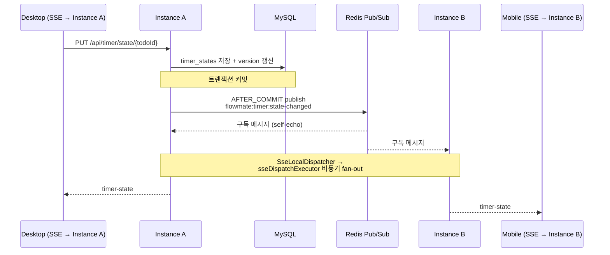
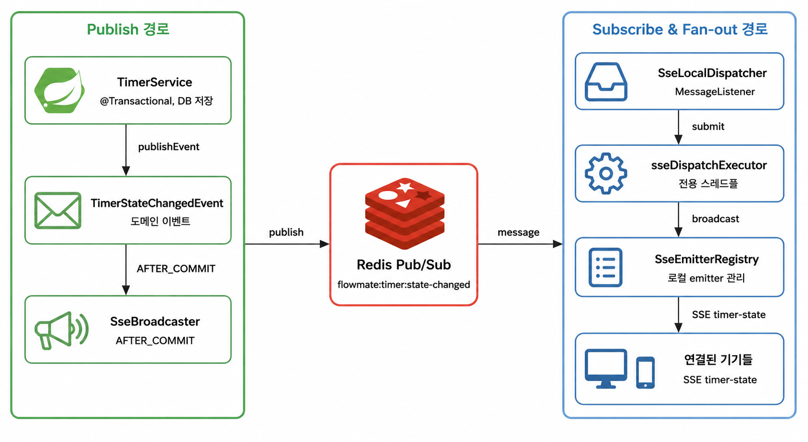

# Redis Pub/Sub으로 SSE 수평 확장하기

> 선행 문서: [SSE 멀티디바이스 타이머 동기화: 단방향 push와 version 기반 순서 보장](sse-sync.md)
>
> 관련 문서: [타이머 상태 저장의 동시성 제어: gap lock deadlock에서 원자적 upsert까지](timer-deadlock.md), [Self-hosted 모니터링을 Alloy + Grafana Cloud로 전환하기](monitoring-stack.md)

## 요약

- **[문제]** SSE 연결을 서버 메모리에 보관해, 서버를 2대 이상으로 늘리면 **다른 서버에 연결된 기기에는 변경이 전달되지 않음**
- **[해결]** 커밋 후 변경을 **Redis Pub/Sub**으로 발행하고 각 서버가 구독해 자기 기기에 전송. 정본은 MySQL이라 메시지를 보관하지 않는 Pub/Sub으로 충분
- **[결과]** 다른 서버에 연결된 기기 **도달률 0→100%**(로컬 서버 2대), 부하 **30,000건 유실 0건**, EC2 배포 후 Redis 채널로 전파 확인

## 1. 문제 배경: 단일 JVM broadcast의 한계

Redis 도입 전에는 `TimerService`가 상태를 저장한 뒤 `SseEmitterRegistry.broadcast()`를 직접 불렀다. `SseEmitterRegistry`는 `userId`별 emitter를 JVM 메모리(`ConcurrentHashMap`)에 보관하고, 같은 `userId`의 모든 emitter에 이벤트를 보낸다. 이 구조는 단일 인스턴스에서는 문제가 없지만, 서버를 늘리면 서버 간 emitter 정보가 공유되지 않아 broadcast 범위가 해당 JVM으로 제한된다.

예를 들어 서버를 2대로 늘리면 다음과 같은 상황이 발생한다.

```text
PUT /api/timer/state/{todoId} ──► Instance A
                          │ SseEmitterRegistry.broadcast(userId)
                          ▼
              Instance A에 연결된 기기만 수신 ✅
              Instance B에 연결된 기기는 수신 불가 ❌
```

Instance A의 `SseEmitterRegistry`는 Instance B의 메모리에 등록된 emitter를 알 수 없다. 따라서 같은 사용자가 PC는 Instance A에, 모바일은 Instance B에
연결한 상태라면 한쪽에서 타이머 상태를 변경해도 다른 쪽 기기에는 이벤트가 전달되지 않는다.

prod는 지금도 서버 1대다. 그래도 먼저 고친 이유는 부하 측정에서 커넥션 풀이나 쿼리보다 호스트 CPU가 먼저 한계에 닿아([모니터링 위키](monitoring-stack.md)) 다음 단계가 서버 증설이었고, 서버를 늘리는 순간 이 결함이 타이머 동기화를 깨기 때문이다. 캐싱 같은 성능 목적도 검토했지만 측정에서 DB 조회가 병목이 아니어서 뺐고, Redis는 MySQL로 대신할 수 없는 서버 간 전파에만 쓴다.

## 2. 대안과 선택: 왜 Redis Pub/Sub인가

서버 간 이벤트 전파에는 여러 선택지가 있다. 이때 핵심 판단 기준은 두 가지였다.

첫째, 메시지 영속성이 필요한가.  
둘째, 추가되는 운영 부담이 현재 문제의 규모에 적절한가.

다음과 같은 선택지를 고려했다.

| 방식                             | 장점                                     | 단점                                                                 | 판단     |
|--------------------------------|----------------------------------------|--------------------------------------------------------------------|--------|
| Sticky Session (userId 해시 라우팅) | 브로커 없이 같은 사용자의 기기를 한 서버로 모을 수 있음        | 서버 장애나 rolling deploy 중에는 같은 사용자의 기기가 서로 다른 서버로 갈라져 다시 전파가 끊김 | 부적합    |
| Kafka                          | 메시지 보장, 파티션 내 순서 보장, replay 지원         | 현재 요구사항 대비 운영과 구성 복잡도가 높음                                          | 과잉     |
| Redis Streams                  | 소비자 그룹, ack, replay 지원                 | 단순 이벤트 전파 목적 대비 구현 복잡도가 높음                                         | 과잉     |
| DB Polling                     | 추가 인프라 불필요                             | 실시간성이 떨어지고 DB 부하가 증가할 수 있음                                         | 부적합    |
| **Redis Pub/Sub**              | 낮은 지연, 구현 단순, Spring Data Redis 연동 용이  | at-most-once 전달로 메시지 유실 가능                                         | **채택** |

WebSocket은 전송 방식의 대안이라 여기서는 다루지 않는다. 서버 간 전파 문제는 WebSocket에도 똑같이 있다. SSE를 고른 이유는 [sse-sync](sse-sync.md)에 있다.

### Redis Pub/Sub을 선택한 이유

메시지 영속성은 필요하지 않았다. 타이머 상태의 단일 정본은 MySQL의 `timer_states`이며, Redis Pub/Sub은 이 정본을 대체하지 않는 휘발성 상태 전파 계층이다. 이벤트가
`state`를 포함하더라도 영속 상태는 MySQL에 남으므로, Pub/Sub 메시지 유실이 곧바로 데이터 손실로 이어지지는 않는다.

운영 부담도 문제 규모에 맞아야 했다. Redis Streams나 Kafka는 메시지 영속성, replay, ack 기반 처리를 제공하지만, 현재 요구사항은 서버 간 이벤트 전파에
한정된다. 이 목적에 비해 Streams/Kafka는 운영 및 구현 복잡도가 크다.

## 3. 아키텍처

### Before: 단일 인스턴스

`SSE 연결 인증`, `register`, `PUT`, `broadcast`가 모두 하나의 JVM 안에서 처리된다(시퀀스는 [sse-sync 3절](sse-sync.md#3-아키텍처)). 서버가 2대 이상이면 각 JVM의 emitter registry가 분리돼, 다른 서버에 등록된 emitter에는 이벤트가 도달하지 못한다.

### After: Redis Pub/Sub 다중 인스턴스

`PUT`을 받은 서버는 트랜잭션 커밋 후 Redis 채널에 publish하고, 해당 채널을 구독 중인 모든 서버는 자기 JVM에 연결된 emitter에 fan-out한다.



발신 서버도 Redis 채널을 구독하므로 자신이 publish한 메시지를 다시 받는다(서버 단위 self-echo). 의도된 동작으로, 모든 서버가 "구독 메시지 수신 → 로컬 emitter fan-out" 한 흐름만 처리하게 해 준다.

발신 기기가 자기 이벤트를 다시 받는 것(기기 단위 self-echo)과 순서가 바뀌어 도착한 이벤트는 기기의 version 비교가 거른다([sse-sync 4.3절](sse-sync.md#self-echo-발신자-식별-없이-전체-broadcast)). 이 비교가 처음부터 충분하지는 않았다는 것은 [6절](#6-배포-후-드러난-문제-redis가-깬-순서-가정)에 적었다.

### 핵심 설계 결정

| 결정                        | 이유                                                        |
|---------------------------|-----------------------------------------------------------|
| **도메인 이벤트로 분리**           | 서비스 코드가 인프라에 직접 의존하지 않아 향후 전파 방식 변경이 쉽다                   |
| **AFTER_COMMIT에 publish** | 커밋 전에 publish하면 롤백될 상태가 전파되는 유령 이벤트가 발생할 수 있다             |
| **fan-out은 전용 executor에 위임** | 기본 리스너 컨테이너는 메시지마다 새 스레드(`SimpleAsyncTaskExecutor`)를 써서, 느린 클라이언트가 몰리면 전송 스레드가 제한 없이 쌓일 수 있다. 그래서 리스너는 역직렬화와 작업 제출만 하고 바로 끝내고, SSE 전송은 스레드 수가 제한된 전용 executor에서 한다 |
| **전파 실패는 요청 처리와 분리**      | 정본은 DB에 있으므로, 전파 실패가 사용자 PUT이나 다른 기기 전송까지 연쇄적으로 막지 않도록 한다 |

## 4. 구현 컴포넌트

| 클래스                      | 역할                                                                                                                                       |
|--------------------------|------------------------------------------------------------------------------------------------------------------------------------------|
| `TimerStateChangedEvent` | 타이머 상태 변경 정보를 담는 도메인 이벤트. `userId`, `todoId`, `version`, `ts`, `state`를 포함한다.                                                            |
| `TimerService`           | 타이머 상태를 DB에 저장하고, 직접 broadcast하지 않고 도메인 이벤트만 발행한다.                                                                                       |
| `SseBroadcaster`         | 트랜잭션 커밋 후 Redis 채널(`flowmate:timer:state-changed`)에 이벤트를 publish한다.                                                                      |
| `SseLocalDispatcher`     | Redis 메시지를 수신한 뒤 `sseDispatchExecutor`에 fan-out 작업을 위임한다.                                                                                |
| `SseEmitterRegistry`     | 기존처럼 `userId`별 emitter를 관리하고, 로컬 JVM에 연결된 기기들에게만 broadcast한다.                                                                            |
| `sseDispatchExecutor`    | Redis 리스너 호출과 SSE 전송을 분리하고 fan-out 스레드 수를 제한하는 전용 스레드풀. `RedisConfig`에서 `@Bean`으로 정의한다. core 4, max 8, 큐 200. 스레드와 큐가 모두 차면 가장 오래된 작업을 버린다(`DiscardOldestPolicy`). |
| `RedisConfig`            | Redis 연결, 메시지 리스너, serializer, executor를 설정한다.                                                                                           |

컴포넌트 흐름은 다음과 같다. Redis 채널을 기준으로 왼쪽은 **publish 경로**, 오른쪽은 **subscribe & fan-out 경로**다.



리팩토링의 핵심은 `TimerService`에서 직접 broadcast 호출을 제거한 것으로, `TimerService`는 DB 저장과 도메인 이벤트 발행까지만 담당하고, Redis publish와 SSE
fan-out은 각각 `SseBroadcaster`, `SseLocalDispatcher`가 담당한다.

덕분에 `upsertState`의 저장과 `version` 계산은 건드리지 않고 이벤트 전파 계층만 Redis Pub/Sub 기반으로 교체할 수 있었다. 그 저장 경로의 동시성 결함과 이후의 원자적 upsert 전환은 [타이머 상태 저장의 동시성 제어 6절](timer-deadlock.md#6-후속-검증과-최종-해결)에 있다.

## 5. 검증

### 5.1 통합 테스트: Redis를 거쳐 로컬 fan-out까지 도달하는가

첫 번째 검증은 하나의 Spring Context에서 Redis publish가 subscriber를 거쳐 로컬 `SseEmitterRegistry.broadcast()`까지 도달하는지 확인하는 통합 테스트다.

> Redis에 publish한 이벤트가 subscriber와 로컬 fan-out 경로까지 도달하는가?

이를 `MultiInstanceSseIntegrationTest`로 먼저 정의했다.

```java

@Test
void 인스턴스A_publish가_인스턴스B_emitter_registry에_도달() {
    TimerStateChangedEvent event = TimerStateChangedEvent.of(
            "user-1", "todo-1", 100L, "{\"status\":\"running\"}"
    );

    timerStateChangedEventRedisTemplate.convertAndSend(SseBroadcaster.CHANNEL, event);

    await().atMost(2, TimeUnit.SECONDS).untilAsserted(() ->
            verify(instanceBRegistry).broadcast(eq("user-1"), any())
    );
}
```

테스트 이름의 '인스턴스B'는 같은 Context 안의 mock `SseEmitterRegistry`이고, Redis는 Testcontainers로 띄운 실제 컨테이너(`redis:7-alpine`)다. 실제 프로세스 간 전달은 다음 절의 로컬 2-JVM 측정으로 따로 확인했다.

이 테스트는 TDD로 진행했다. `SseLocalDispatcher` 구현 전에는 Redis 메시지를 받아 로컬 emitter로 fan-out할 구독자가 없으므로 `broadcast()`가 호출되지 않아 `RED`를 확인했다.

이후 `SseLocalDispatcher`를 구현해 Redis 채널을 구독하고, 수신 메시지를 `SseEmitterRegistry.broadcast()`로 전달하자 `GREEN`을 확인했다.

커밋할 때만 publish하는지(`SseBroadcasterTest`), publish 실패가 요청으로 번지지 않는지(`SseBroadcasterFailSilentTest`), 느린 전송 중에도 리스너가 바로 반환하는지(`SseLocalDispatcherTest`)도 테스트로 확인했다.

### 5.2 로컬 서버 2대(2-JVM) Before / After 측정

단순한 테스트 외에도 실제로 로컬 환경에서 JVM을 2개 띄워 동일 문제를 재현했다.

`8080`, `8081` 두 프로세스를 같은 로컬 MySQL에 연결하고, 동일 사용자 기준으로 8080에만 `PUT` 요청 5회를 보낸 뒤 8081에 연결된 SSE 클라이언트의 수신 건수를 확인했다.

| 측정 항목                          | Before (`main`) | After (`feat/redis-sse-tdd`) |
|--------------------------------|----------------:|-----------------------------:|
| Device A (8080) timer-state 수신 |               5 |                            5 |
| Device B (8081) timer-state 수신 |           **0** |                        **5** |
| **서버 간 도달률**                  |          **0%** |                     **100%** |
| Redis publish 메시지 수            |               0 |                            5 |

Before에서는 이벤트가 8080 JVM 메모리 안에서만 broadcast되어 8081의 클라이언트는 아무 이벤트도 받지 못했다.

After에서는 Redis Pub/Sub을 통해 두 서버 모두 메시지를 수신했고, 8081에 연결된 클라이언트도 5건 모두 정상 수신했다.

### 5.3 부하 측정

부하는 Node 스크립트로 걸었다(k6는 SSE 스트림을 이벤트 단위로 읽지 못한다). 사용자마다 SSE 연결 1개를 서버 B(`:8081`)에 열고, PUT은 서버 A(`:8080`)로만 보내 서버 간 경로만 쟀다. **유실**은 성공한 PUT 중 B에 도착하지 않은 건수, **지연**은 PUT 송신부터 B의 SSE 수신까지다.

| 단계 | 동시 연결 | 실제 송신(건/s) | 이벤트 수  | 도달률      | 유실     | p50  | p95   | p99   |
|----|-------|-----------|--------|----------|--------|------|-------|-------|
| 1  | 10    | 20        | 600    | **100%** | **0건** | 15ms | 20ms  | 93ms  |
| 2  | 50    | 97        | 3,000  | **100%** | **0건** | 6ms  | 8ms   | 11ms  |
| 3  | 100   | 478       | 12,000 | **100%** | **0건** | 6ms  | 10ms  | 22ms  |
| 4  | 200   | 918       | 30,000 | **100%** | **0건** | 11ms | 108ms | 244ms |

4단계에서 보낸 30,000건이 모두 B에 도착했다. 부하가 늘며 커진 것은 유실이 아니라 지연 꼬리였다(p95 8ms → 108ms). 4단계는 초당 1,000건, 추가로 돌린 단계는 3,000건을 목표로 했지만 단일 드라이버가 둘 다 초당 약 920건에서 막혀, 이 측정에서 서버가 받은 최대 부하는 초당 약 920건이다.

### 5.4 dev EC2 Redis 채널 확인

로컬 검증 뒤 dev EC2에 Redis를 배포하고, Redis 채널을 직접 구독한 상태로 브라우저에서 타이머를 조작했다. dev는 서버가 1대라, 이 확인은 서버 간 전파가 아니라 배포 환경에서 publish가 Redis 채널에 닿는지를 본 것이다(서버 간 전파는 5.2, 5.3절).

`/actuator/health`에서 publish용과 구독용 Redis 연결이 모두 `UP`이었다.

```text
$ docker exec flowmate-redis-dev redis-cli -a *** SUBSCRIBE flowmate:timer:state-changed

# 타이머 시작
{"userId":"8fbb...","todoId":"b705...","version":1782170915939,
 "state":"{...\"status\":\"running\"...}"}

# 일시정지
{"userId":"8fbb...","todoId":"b705...","version":1782170925205,
 "state":"{...\"status\":\"paused\"...}"}
```

캡처의 `version`은 순차 version으로 바꾸기 전 방식(현재 시각 ms)이라 큰 값이다. Grafana Loki에서 publish 실패(`sse.publish.failed`)와 구독 쪽 처리 실패(`sse.dispatcher.exception`) 경고는 0건이었다.

## 6. 배포 후 드러난 문제: Redis가 깬 순서 가정

Redis 도입 전에는 `PUT`을 처리한 요청 스레드가 그 자리에서 broadcast해, 이벤트가 거의 순서대로 즉시 도착했다. Redis 도입 뒤에는 이벤트가 Redis를 돌아오고 여러 스레드가 나눠 보내므로, 서버가 1대여도 늦게 오거나 순서가 바뀔 수 있다.

v1.12.0 배포 당일 prod에서 이 변화가 숨어 있던 결함을 드러냈다. 스톱워치를 완료하자 다음 일이 일어났다.

```text
완료한 탭 : pause(v1) → 세션 저장(키 K1) → Todo 완료 → reset(v2)
어떤 탭   :          늦게 온 pause(v1)로 타이머가 되살아남 → reset(v2) 수신 → 진행 구간을 새 키 K2로 다시 저장
```

같은 5,391초 세션이 서로 다른 키로 두 번 저장돼 Todo 집계가 두 배가 됐다. 원인은 원래 코드에 있었다. reset을 받기만 한 탭도 세션을 저장했고, 멱등키(`clientSessionId`)를 저장할 때마다 새로 만들어 `UNIQUE(todo_id, client_session_id)`가 중복을 막지 못했다.

v1.12.1에서 프론트엔드만 고쳤다.

- reset을 받은 탭은 타이머만 지우고, 세션은 reset을 보낸 탭만 저장한다.
- 같은 version의 이벤트도 버리고(`version < last` → `version <= last`), `PUT` 응답의 version을 기록해 늦게 온 자기 이벤트가 끝난 타이머를 되살리지 못하게 한다.
- 완료 시 세션 저장이 실패하면 reset과 Todo 완료를 막는다.

reset 이벤트가 pause 앞에 오든 뒤에 오든, 두 번 오든 세션이 하나만 생기는지 회귀 테스트로 확인했다.

## 7. 트레이드오프 요약

이번 구조의 핵심 트레이드오프는 메시지 보장보다 단순한 이벤트 전파를 우선한 것이다.

| 결정                       | 얻은 것                                             | 감수한 비용                                                                  | 판단                                  |
|--------------------------|--------------------------------------------------|-------------------------------------------------------------------------|-------------------------------------|
| **Redis Pub/Sub 채택**     | 단순한 구조로 서버 간 이벤트 전파 가능                         | at-most-once 특성상 메시지 유실 가능                                              | 최종 상태는 MySQL에 있으므로 유실이 곧 데이터 손실은 아님 |
| **AFTER_COMMIT publish** | DB에 확정된 상태만 전파 | 커밋 뒤 publish가 실패하거나 그 사이 프로세스가 죽으면 다시 보내지 않음(outbox 없음) | 유령 broadcast를 막는 쪽을 택함 |
| **비동기 fan-out**          | 느린 SSE 클라이언트가 있어도 fan-out 스레드가 8개를 넘지 않음 | 큐 포화 시 오래된 전송을 버림, 같은 사용자 이벤트의 전송 순서 미보장(기기의 version 비교가 거름) | 스레드가 제한 없이 느는 것보다 포화 시 오래된 작업을 버리는 쪽을 택함 |
| **전파 실패와 요청 처리 분리**      | Redis 장애나 개별 emitter 실패가 사용자 `PUT`과 DB 저장을 막지 않음 | Redis 장애 중에는 실시간 동기화가 중단될 수 있음                                          | DB 데이터는 남는다. 단 서버 1대에서도 실시간 동기화가 멈춘다(8절) |

## 8. 한계

- **놓친 이벤트를 자동으로 다시 받지 않는다.** Pub/Sub은 구독이 끊긴 동안의 메시지를 다시 주지 않고, executor가 포화되면 오래된 전송을 버린다. 클라이언트는 SSE 재연결 때 상태를 다시 조회하지 않으므로, 다른 기기 화면은 그 Todo에 다음 이벤트가 오거나 앱을 다시 열 때까지 이전 상태일 수 있다. 정본은 MySQL에 남는다.
- **Redis가 멈추면 같은 서버에 붙은 기기도 이벤트를 받지 못한다.** 로컬 전송도 Redis를 거쳐 돌아오기 때문이다. `PUT`과 DB 저장은 성공하지만, 서버 1대인 지금 prod에 Redis 도입 전에 없던 의존이 생겼고 backend 기동에도 Redis가 필요하다.
- **부하 측정은 서버 2대, Redis, MySQL, 드라이버를 모두 한 머신에서 했고, executor 큐가 차는 지점까지 가지 못했다.** 이 결과는 "이 부하에서 유실이 없었다"이지 "큐 포화에서도 유실이 없다"가 아니다.

## 9. 회고

### "정본이 있다"와 "복구가 자동으로 된다"는 다르다

at-most-once를 받아들인 근거는 타이머 상태의 정본이 MySQL에 있다는 것이었다. 하지만 정본이 남아 있어도 다시 읽어 오는 경로가 없으면 놓친 이벤트는 화면에 반영되지 않는다. 지금 보장하는 것은 "데이터를 잃지 않는다"까지이고, "화면이 알아서 맞춰진다"는 재연결 시 재조회를 구현해야 말할 수 있다.

### 단일 JVM의 "순서대로 즉시" 가정이 Redis 도입으로 깨졌다

설계 단계에서는 전파 계층만 바꾸면 되고, 발신 기기가 받는 자기 이벤트는 기기의 version 비교가 거른다고 보았다. 그런데 그 비교와 reset 처리 코드는 이벤트가 순서대로 즉시 온다는, 단일 JVM에서만 사실상 성립하던 가정에 기대고 있었다. 전달 경로를 바꿀 때는 받는 쪽 코드가 순서와 중복에 대해 무엇을 가정하는지도 함께 확인해야 했다.

### 1대 prod에 Redis 가용성 의존을 더했다

Redis는 서버를 늘릴 때를 대비해 넣었지만, prod가 1대인 지금은 다중 서버의 이득이 아직 없다. 반대로 로컬 전송까지 Redis를 거치게 만든 탓에, Redis가 멈추면 1대 환경의 실시간 동기화도 멈추는 의존은 배포와 동시에 생겼다. 확장용 구성 요소를 넣을 때는 현재 구성에 새로 생기는 장애 지점도 같은 무게로 따졌어야 했다.
