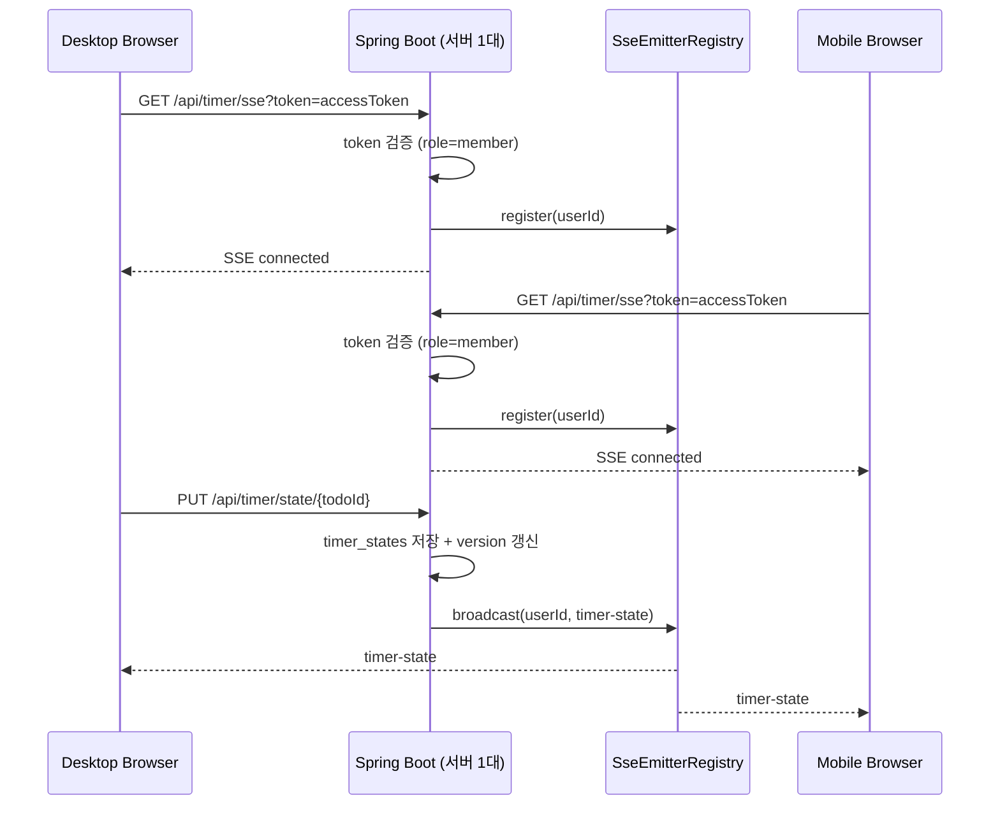

# SSE 멀티디바이스 타이머 동기화: 단방향 push와 version 기반 순서 보장

> 후속 문서: [Redis Pub/Sub으로 SSE 수평 확장하기](redis-sse-pubsub.md), [SSE 연결 유지 실패 해결: Workbox 충돌과 Nginx idle timeout](sse-timeout.md)
>
> 관련 문서: [타이머 상태 저장의 동시성 제어: gap lock deadlock에서 원자적 upsert까지](timer-deadlock.md)

## 요약

- **[문제]** 타이머 상태가 브라우저 안(localStorage)에만 있어 **같은 계정이어도 기기 간 공유되지 않음**
- **[해결]** 조작은 REST로 저장하고 변경은 DB가 계산한 **순차 version**을 붙여 **SSE**로 보내, 이미 반영된 이벤트는 기기가 무시
- **[결과]** 같은 계정의 모든 기기에 **역전 없이 최신 상태 공유**

## 1. 문제 배경: 기기 간 상태 공유 부재

FlowMate의 타이머는 할 일(Todo)마다 따로 돌아간다. 초기에는 이 상태를 브라우저 안(Zustand 스토어와 localStorage)에만 저장했다. 같은 기기에서는 새로고침해도 유지됐지만, 다른 기기에서는 이 상태를 볼 수 없었다.

```text
Desktop: 25분 뽀모도로 시작 (running)
                ↓ 사용자가 모바일로 전환
Mobile:  타이머 없음 (idle) ❌
```

요구사항은 두 가지였다.

- 한 기기에서 타이머를 변경하면 다른 기기에 즉시 반영될 것
- 변경 알림이 늦게 도착해 순서가 뒤바뀌어도 최신 상태를 유지할 것

단, 게스트는 동기화하지 않는다. 게스트는 기기마다 따로 발급된 토큰으로 구분되므로, 두 기기가 같은 게스트 계정을 쓸 일이 없다.

## 2. 대안과 선택: WebSocket vs Polling vs SSE

실시간 기능이라도 데이터가 흐르는 방향과 빈도에 따라 맞는 방식이 다르다. 타이머는 기기 -> 서버 요청이 시작, 일시정지, 재개, 정지, 페이즈 전환처럼 상태가 바뀔 때만 생기므로 REST PUT으로 충분했다. 서버 -> 기기는 다른 기기의 변경을 바로 알려야 하므로, 미리 열어 둔 연결로 서버가 먼저 보내는 push가 필요했다.

| 방식 | 맞는 경우 (예시) | 타이머에 쓰면 | 판단 |
|---|---|---|---|
| WebSocket (STOMP) | 양쪽이 자주 보냄 (채팅, 협업 편집, 게임) | 쓰지 않을 기기 -> 서버 실시간 채널과 STOMP 구독, 세션 관리까지 떠안음 | 과잉 |
| Polling | 가끔 바뀌고 몇 초 늦어도 됨 (대시보드 갱신) | 페이즈가 바뀌는 순간 다른 기기에 몇 초간 이전 상태가 보일 수 있고, 빈 응답 트래픽이 생김 | 부적합 |
| **SSE + REST** | **서버만 자주 보냄** (알림, 주식 시세, 진행 상황) | 일반 HTTP라 Nginx 설정만 더하고 Spring `SseEmitter`를 그대로 씀. 조작은 REST로 따로 보냄 | **채택** |

## 3. 아키텍처

서버가 한 대일 때는 `SseEmitterRegistry`가 사용자별 SSE 연결(emitter)을 서버 메모리에 들고 있으므로, 타이머 상태가 바뀌면 그 사용자의 모든 기기에 이벤트를 보낼 수 있다.



이 그림은 Redis 도입 전 구조다. 지금은 이벤트를 Redis 채널로 보내고, 각 서버가 받아 자기에게 연결된 기기에 전달한다([Redis Pub/Sub 확장](redis-sse-pubsub.md)).

## 4. 구현

타이머 상태의 기준은 MySQL에 저장된 값 하나다. 앱을 열면 `GET /api/timer/state`로 현재 상태를 받아온다.

### 4.1 스키마

```sql
CREATE TABLE timer_states
(
    todo_id    VARCHAR(36)  NOT NULL PRIMARY KEY,
    user_id    VARCHAR(36)  NOT NULL,
    state_json TEXT         NULL,
    version    BIGINT       NOT NULL DEFAULT 0,
    updated_at TIMESTAMP(3) NOT NULL DEFAULT CURRENT_TIMESTAMP(3),
    created_at TIMESTAMP(3) NOT NULL DEFAULT CURRENT_TIMESTAMP(3),

    CONSTRAINT fk_timer_states_todo
        FOREIGN KEY (todo_id) REFERENCES todos (id) ON DELETE CASCADE
);
CREATE INDEX idx_timer_states_user ON timer_states (user_id, updated_at DESC);
```

| 컬럼                      | 설계 결정                                                     |
|-------------------------|-----------------------------------------------------------|
| `todo_id` PK            | Todo 하나에 타이머 상태 하나(1:1)라 별도 ID가 필요 없음                                |
| `user_id`               | 소유 사용자. 앱을 열 때 이 사용자의 상태를 찾는 조건 |
| `state_json`            | `NULL`이면 idle, JSON이면 활성 상태                               |
| `version`               | 기기가 이벤트가 최신인지 판단하는 값. 저장할 때마다 DB가 Todo별로 1씩 올림                 |
| `updated_at`            | 서버가 저장할 때 넣는 시각. 24시간이 지난 상태는 복원하지 않는 기준 |

### 4.2 `version`: Todo별 순차 증가

상태를 저장할 때마다 DB가 같은 Todo의 직전 `version`에 1을 더한다(새 행은 1).

```sql
INSERT INTO timer_states (todo_id, user_id, state_json, version, created_at, updated_at)
VALUES (:todoId, :userId, :stateJson, 1, :now, :now) AS incoming
ON DUPLICATE KEY UPDATE
    state_json = incoming.state_json,
    version    = timer_states.version + 1,
    updated_at = incoming.updated_at
```

최초 저장과 갱신을 한 문장으로 처리하고, 같은 Todo에 동시에 들어온 쓰기는 행 락으로 한 줄로 선다. 그래서 먼저 커밋된 쓰기가 항상 더 작은 version을 받는다. 저장한 트랜잭션 안에서 확정된 version을 다시 읽어 API 응답과 SSE 이벤트에 똑같이 싣는다. 다만 이 순서는 버튼을 누른 순서가 아니라 DB에 커밋된 순서라, 두 기기에서 거의 동시에 누르면 나중에 커밋된 쪽이 최종 상태가 된다.

처음에는 서버가 version을 계산했는데, 동시 저장에서 version이 겹치거나 역전되는 문제가 드러나 계산을 DB 한 문장인 원자적 upsert로 옮겼다(경위는 [타이머 상태 저장의 동시성 제어](timer-deadlock.md#6-후속-검증과-최종-해결)).

### 4.3 늦게 온 이벤트는 기기가 거른다

version은 저장된 순서대로 매겨지지만, 기기에 도착하는 순서는 뒤바뀔 수 있다. 저장 요청마다 이벤트가 따로 나가고, 기기로 보내는 작업도 별도 스레드에서 각자 처리되기 때문이다.

그래서 기기는 도착 순서가 아니라 version 숫자로 최신인지 판단한다. Todo마다 마지막으로 화면에 반영한 version을 기억해 두고(`seenVersions`), 새 이벤트의 version이 그보다 크면 반영한다. 같거나 작으면 이미 지난 상태로 보고 버린다.

```text
기기 A가 일시정지 → v=100
기기 B가 재개     → v=101
기기 C에 v=101이 먼저, v=100이 나중에 도착
→ C는 이미 101을 적용했으므로 v=100은 무시
```

#### 자기 이벤트(self-echo)도 version으로 거른다

서버는 같은 사용자의 모든 SSE 연결에 같은 이벤트를 보내므로, PUT을 보낸 기기도 자기 이벤트를 다시 받는다(self-echo). 보낸 기기만 빼려면 서버가 어느 SSE 연결이 그 기기인지 알아야 해 기기 식별자를 따로 주고받아야 한다. 그래서 서버는 그대로 두고 version 비교로 거른다. 기기는 PUT 응답으로 받은 version을 `seenVersions`에 기록해 두므로, 같은 version으로 돌아온 자기 이벤트는 이미 반영한 것으로 보고 버린다. 자기 이벤트가 응답보다 먼저 도착하는 경우의 예외는 6절에 적었다.

### 4.4 Soft Delete: state_json = NULL

타이머를 정지하거나 초기화해 idle 상태가 되면, 행을 삭제하지 않고 `state_json`만 `NULL`로 바꾼다.

```text
v=100: running   state_json = "{...}"
v=101: idle      state_json = NULL    (행 유지)
v=102: running   state_json = "{...}"
```

이유는 **version 연속성**이다. version은 같은 행의 직전 값에 1을 더하므로, 행을 지우면 다시 만들어진 행이 1부터 시작한다. 그런데 열려 있던 탭은 이전에 본 큰 version을 기억하고 있어(4.3), 1부터 다시 오는 새 이벤트를 모두 지난 것으로 보고 새로고침할 때까지 버린다. 같은 이유로 "24시간 넘게 갱신이 없는 상태는 복원하지 않는다"는 정책도 행을 지우지 않고 조회 조건(`updated_at >= 지금 - 24시간`)으로만 적용한다. 행은 Todo가 삭제될 때만 함께 삭제된다.

### 4.5 SseEmitterRegistry: 연결 관리와 broadcast

`SseEmitterRegistry`는 사용자별로 열린 SSE 연결을 모두 보관하고, 이벤트가 오면 그 사용자의 연결 전체에 보낸다.

```java
private final ConcurrentHashMap<String, CopyOnWriteArrayList<ConnectionEntry>> connections;

private record ConnectionEntry(String internalId, SseEmitter emitter, ScheduledFuture<?> heartbeatTask) {
}
```

연결 등록, 제거, 전송이 여러 스레드에서 동시에 일어나므로 동시성 컬렉션을 쓴다. `ConcurrentHashMap`은 사용자 키를 동시에 넣고 빼도 안전하고, `CopyOnWriteArrayList`는 변경할 때마다 복사본을 만들어 전송이 목록을 도는 중에 연결이 추가되거나 제거돼도 안전하다. 전송은 잦고 연결 변경은 드물어 복사 비용이 작다.

연결이 끊기면 `internalId`로 그 연결만 찾아 지우고, 그 연결의 heartbeat 작업도 함께 취소한다.

#### 등록과 1시간 timeout

```java
SseEmitter emitter = new SseEmitter(SSE_TIMEOUT_MS); // 1시간

emitter.onCompletion(() -> removeEntry(userId, internalId));
emitter.onTimeout(() -> removeEntry(userId, internalId));
emitter.onError(e -> removeEntry(userId, internalId));

emitter.send(SseEmitter.event().name("connected").data("ok"));
```

연결 직후 `connected` 이벤트를 한 번 보내, 기기가 SSE 연결 성공을 바로 알 수 있게 한다. 연결은 정상 종료, 1시간 timeout, 오류 중 하나로 끊기는데 정리 로직은 같으므로 세 콜백 모두 `removeEntry`를 호출한다. 1시간이 지나 서버가 연결을 닫으면 브라우저 `EventSource`가 자동으로 다시 연결한다.

#### 25초 heartbeat

연결마다 25초 간격으로 `heartbeat` 이벤트를 보내는 작업을 등록한다(`scheduleAtFixedRate`). Nginx(`proxy_read_timeout 3600s`)와 `SseEmitter`의 timeout은 1시간이지만, 그래도 heartbeat를 두는 이유는 두 가지다.

- **중간 장비가 연결을 끊지 않게**: 기기와 서버 사이의 통신사 NAT, 프록시, 방화벽은 한동안 데이터가 오가지 않는 연결을 끊을 수 있고, 그 시간은 장비마다 달라 서버가 정할 수 없다. 25초마다 데이터를 흘려 연결이 쉬는 상태로 남지 않게 한다.
- **끊긴 연결을 빨리 정리**: 브라우저를 닫거나 네트워크가 끊겨도 서버는 보내 보기 전까지 모른다. 보낼 이벤트가 없으면 이런 연결이 1시간 timeout까지 남으므로, heartbeat 전송이 실패하는 시점에 그 연결과 heartbeat 작업을 정리한다.

#### broadcast: 실패해도 기다리지 않는다 (fire-and-forget)

`broadcast`는 그 사용자의 연결에 하나씩 이벤트를 보내고, 실패해도 다시 보내거나 예외를 던지지 않는다. 한 연결에서 전송이 실패하면 그 연결만 정리하고 다음 연결로 넘어가, 끊긴 기기 하나 때문에 나머지 기기가 이벤트를 못 받는 일을 막는다. 상태는 이미 MySQL에 커밋돼 있으므로 이벤트를 놓쳐도 데이터는 잃지 않는다. 놓친 기기는 그 Todo의 다음 이벤트를 받거나 앱을 다시 열 때 최신 상태로 맞춰진다(6절).

### 4.6 SSE 인증: 쿼리 파라미터 기반 토큰 전달

브라우저 표준 `EventSource` API는 요청 헤더를 붙일 수 없어, 다른 API처럼 `Authorization` 헤더로 토큰을 보낼 수 없다. 그래서 토큰을 URL 쿼리 파라미터로 보낸다.

```js
// 불가능
new EventSource('/api/timer/sse', {headers: {'Authorization': 'Bearer ...'}})

// 쿼리 파라미터로 토큰 전달
new EventSource(`/api/timer/sse?token=${encodeURIComponent(token)}`)
```

이 경로는 헤더가 없어 일반 API의 JWT 필터가 처리하지 않으므로, 컨트롤러가 직접 검증한다. `parseToken` 한 번으로 서명과 만료를 확인하고, 회원(`role=member`)이 아니면 401로 거절한다.

| 방식                       | 장점                                   | 단점                            | 판단     |
|--------------------------|--------------------------------------|-------------------------------|--------|
| 단기 SSE 티켓 발급             | access token 원문 노출 방지, 노출 시 영향 범위 축소 | 발급 API, 저장소, 만료 정책, 일회성 처리 필요 | 과잉     |
| **쿼리 파라미터 access token** | 별도 인프라 없이 기존 토큰 재사용                  | URL과 액세스 로그에 토큰이 남음                     | **채택** |

쿼리 파라미터로 access token을 전달하면 요청 URL이 기록되는 곳(액세스 로그 등)에 토큰도 남는다(6절). 대신 HTTPS로 전송 구간을 보호하고 Access Token TTL을 15분으로 짧게 유지해([토큰 정책](auth-evolution.md#토큰-정책)), 노출되더라도 재사용할 수 있는 시간을 제한한다.

## 5. 트레이드오프 요약

이 설계의 핵심 트레이드오프는 전달 보장보다 단순함을 택한 것이다. 이벤트는 놓칠 수 있지만, 상태는 MySQL에 남아 있고 다음 이벤트가 전체 상태를 싣고 오므로 감수했다.

| 결정 | 얻은 것 | 감수한 비용 | 판단 |
|---|---|---|---|
| **SSE + REST** | 별도 인프라 없이 Spring 기본 기능으로 구현 | 조작은 REST로 따로 보냄 | 서버 -> 기기 push만 필요 |
| **순차 version (DB 원자적 증가)** | 먼저 커밋된 쓰기가 더 작은 version | MySQL 전용 네이티브 SQL, 거의 동시에 누르면 나중 커밋이 이김 | 마지막으로 커밋된 쓰기가 남는(LWW) 타이머에는 충분 |
| **broadcast fire-and-forget** | 끊긴 연결 하나가 나머지 전송을 막지 않음 | 일부 이벤트 누락 가능 | 다음 이벤트나 SSE 재연결 때의 재조회로 복구(6절) |
| **query param 토큰** | 기존 토큰 재사용 | URL과 액세스 로그에 토큰이 남음 | 짧은 TTL(15분)과 HTTPS로 수용 |

## 6. 한계

- **연결이 살아 있는 채로 빠진 이벤트는 바로 복구되지 않는다.** SSE가 다시 연결되면 기기가 진행 중인 상태를 다시 조회해 끊긴 동안의 변경을 맞춘다. 하지만 연결은 그대로인데 이벤트만 빠지면(Redis 발행 실패, 전송 큐 포화) 재조회가 일어나지 않아, 그 Todo에 다음 이벤트가 오거나(이벤트는 전체 상태를 싣는다) 앱을 다시 열 때 맞춰진다([Redis Pub/Sub 위키 6절](redis-sse-pubsub.md#6-장애-모드와-보장-범위)).
- **발신 기기 화면이 잠시 이전 상태로 돌아갈 수 있다.** 예를 들어 일시정지(v=5로 저장)를 누르고 바로 재개를 눌렀는데, v=5 자기 이벤트가 PUT 응답보다 먼저 오면 화면이 잠시 일시정지로 돌아간다. 재개가 v=6으로 저장되고 그 이벤트가 오면 다시 맞춰진다.
- **실패한 PUT 재시도는 멱등하지 않다.** 서버는 저장했는데 응답만 잃어버린 경우, 기기가 같은 상태를 다시 보내 version이 한 번 더 오른다. 그사이 다른 기기가 바꾼 상태가 있으면 이 재시도가 덮어쓴다.
- **SSE 토큰이 Nginx 액세스 로그에 남는다.** SSE 경로의 액세스 로그를 끄거나 쿼리를 지운 로그 형식을 쓰면 줄일 수 있지만 아직 적용하지 않았다.

## 7. 회고

### 기술보다 통신 방향을 먼저 따졌다

실시간 기능이라고 하면 보통 WebSocket을 먼저 떠올린다. 이번에는 기술 이름보다 데이터가 어느 방향으로 얼마나 자주 흐르는지를 먼저 따졌고, 그래서 쓰지 않을 양방향 채널 없이 SSE와 REST만으로 만들 수 있었다. 순서 보장도 전송 채널에 맡기지 않고 version으로 기기가 직접 판단하게 했다.

### SSE는 코드 구현만으로 끝나지 않았다

코드로 SSE를 구현하는 것과, 그 연결이 실제 HTTPS 환경에서 끊기지 않고 유지되는 것은 별개의 문제였다. dev에 처음 올렸을 때 서비스워커(Workbox)가 SSE 요청을 가로채 연결이 되지 않았고, 이를 고친 뒤에는 Nginx가 기본 설정대로 60초 동안 데이터가 없는 연결을 끊었다. SSE 경로의 timeout을 1시간으로 늘리고 heartbeat를 넣어 해결했다. 브라우저와 인프라가 긴 연결을 어떻게 다루는지 모른 채 시작했기 때문이다. 이 과정은 [SSE 연결 유지 실패 해결](sse-timeout.md)에 정리했다.

### 서버 한 대를 전제로 한 설계였다

`SseEmitterRegistry`는 연결을 서버 메모리에 보관하므로, 서버가 2대 이상이 되면 다른 서버에 연결된 기기에는 이벤트가 닿지 않는다. 처음에는 서버 한 대만 운영해 드러나지 않았다. 이 문제는 이후 Redis Pub/Sub으로 해결했고, [Redis Pub/Sub으로 SSE 수평 확장하기](redis-sse-pubsub.md)에 정리했다.
