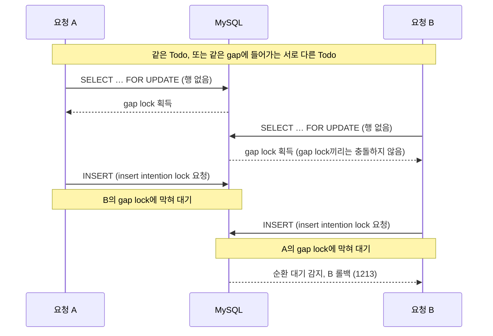

# 타이머 상태 저장의 동시성 제어: gap lock deadlock에서 원자적 upsert까지

> 관련 문서: [SSE 멀티디바이스 타이머 동기화: 단방향 push와 version 기반 순서 보장](sse-sync.md)

## 요약

- **[문제]** 부하테스트에서 타이머를 **최초 동시 저장할 때**, 비관적 락으로 같은 빈 구간을 잠근(**gap lock**) 요청끼리 서로의 저장을 막아 deadlock 69건 발생
- **[1차 해결]** 비관적 락을 제거해 gap lock을 없애고, 최초 동시 저장 시 **중복 저장 충돌로 실패하면** 다시 읽어 갱신하는 **catch-retry**로 복구 시도
- **[2차 해결]** 최초 저장은 재시도로도 실패하고, 동시 갱신은 락 제거로 **SSE에서 최신 상태를 가려내는 version**이 겹쳐, **둘 다 DB 원자적 연산 upsert로 처리**
- **[결과]** 1차는 deadlock **69 → 0건**, 2차는 같은 Todo에 4건씩 30번 최초 동시 저장 **30/120 → 120/120 성공**, version 겹침과 역전 0건(MySQL 통합 테스트)

## 1. 문제 배경

FlowMate의 타이머는 상태를 서버에 저장하고 [SSE로 멀티디바이스 동기화](sse-sync.md)한다. Todo마다 `timer_states` 행이 하나 있고, 타이머를 처음 시작할 때 이 행이 생긴다(최초 저장). 저장할 때마다 version을 올리고, 각 기기는 version이 더 큰 이벤트만 화면에 반영한다.

### 부하테스트에서 발견

dev 환경에서 k6 baseline 부하테스트(가상 사용자 최대 12명, 10분)를 돌렸다. 전체 112,132건 중 실패율은 0.06%로 낮았지만, 엔드포인트별로 쪼개자 실패가 한 경로에 몰려 있었다.

| 실패 구간                           | 실패 수 |
|---------------------------------|-----:|
| `PUT /api/timer/state/{todoId}` |   69 |
| 기타 API                          |    0 |

[Grafana Cloud](monitoring-stack.md)에서 본 같은 구간 백엔드 예외도 69건이었고, 로그에 반복된 예외는 1213 deadlock이었다.

## 2. 원인

### 증상

백엔드 로그에는 다음과 같은 에러가 남아 있었다.

```text
2026-03-26T10:43:03.672Z  WARN  ... ErrorCode: 1213, SQLState: 40001
2026-03-26T10:43:03.672Z  WARN  ... Deadlock found when trying to get lock; try restarting transaction
2026-03-26T10:43:03.673Z ERROR ... CannotAcquireLockException

org.springframework.dao.CannotAcquireLockException:
could not execute statement
[Deadlock found when trying to get lock; try restarting transaction]
[insert into timer_states (created_at,state_json,updated_at,user_id,version,todo_id) values (?,?,?,?,?,?)]
```

ErrorCode 1213(SQLState 40001)은 InnoDB deadlock이고, 실패한 문장은 `timer_states`의 최초 저장 INSERT였다.

### 왜 처음에 락을 걸었나

당시 repository 조회에는 비관적 락인 `@Lock(PESSIMISTIC_WRITE)`를 걸었다.
동시에 같은 Todo의 타이머 상태를 바꾸는 요청이 들어와도 `SELECT FOR UPDATE`로 행을 잠그고, `version` 증가가 꼬이지 않도록 하려는 의도였다.

### 왜 문제가 됐나

문제의 핵심은 `timer_states`에 행이 아직 없을 때의 최초 저장 경로였다. 조회 결과가 없으면 새 행을 만들어 INSERT하는 구조였다.

행이 이미 존재할 때는 이 전략이 의도대로 동작한다.
`SELECT FOR UPDATE`가 해당 record lock을 잡고, 다른 요청은 앞선 트랜잭션이 끝날 때까지 기다린다.

하지만 행이 없으면 잠글 record가 없다.
이때 InnoDB는 존재하지 않는 행 대신 인덱스의 빈 공간인 gap을 잠글 수 있다.
여러 요청이 동시에 gap lock을 잡은 뒤 INSERT를 시도하면, INSERT에 필요한 insert intention lock이 서로의 gap lock과 충돌하면서 deadlock이 발생할 수 있다.



### deadlock graph로 확인

부하테스트 없이 같은 Todo에 최초 저장 16건을 동시에 보내도 deadlock이 재현됐다. 이때 확인한 `SHOW ENGINE INNODB STATUS\G`의 deadlock graph는 다음과 같다.

```text
*** (1) TRANSACTION:
TRANSACTION 167508, ACTIVE 0 sec inserting

*** (1) HOLDS THE LOCK(S):
RECORD LOCKS space id 10 page no 4 index PRIMARY
  lock_mode X locks gap before rec

*** (1) WAITING FOR THIS LOCK TO BE GRANTED:
RECORD LOCKS space id 10 page no 4 index PRIMARY
  lock_mode X locks gap before rec insert intention waiting

*** (2) TRANSACTION:
TRANSACTION 167514, ACTIVE 0 sec inserting

*** (2) HOLDS THE LOCK(S):
RECORD LOCKS space id 10 page no 4 index PRIMARY
  lock_mode X locks gap before rec

*** (2) WAITING FOR THIS LOCK TO BE GRANTED:
RECORD LOCKS space id 10 page no 4 index PRIMARY
  lock_mode X locks gap before rec insert intention waiting
```

두 트랜잭션 모두 `PRIMARY` 인덱스의 gap lock을 보유한 채 insert intention lock을 기다리고 있었다.

### 서로 다른 Todo끼리도 충돌했다

k6 시나리오는 반복마다 새 Todo를 만들어 같은 Todo에 요청이 겹치지 않았는데도 deadlock이 났다. 그래서 같은 방식으로 서로 다른 `todo_id` 16개에 최초 저장을 동시에 보내자 16건 중 11건이 deadlock(1213)으로 실패했다. `SHOW ENGINE INNODB STATUS`도 같은 `PRIMARY` 인덱스의 gap lock deadlock을 보였다.

gap lock은 키 하나가 아니라 그 키가 들어갈 빈 구간을 잠근다. 예를 들어 기존 행의 `todo_id`가 30, 90 두 개라면 gap은 `30 이전`, `30~90`, `90 이후` 세 개다.

| 경우 | 새로 저장하는 todo_id | 들어갈 gap | 결과 |
|---|---|---|---|
| 같은 Todo | 50, 50 | 둘 다 `30~90` | 같은 gap을 잠금 → deadlock |
| 서로 다른 Todo | 50, 70 | 둘 다 `30~90` | 같은 gap을 잠금 → deadlock |
| 서로 다른 Todo | 50, 95 | `30~90`, `90 이후` | 다른 gap → 충돌 없음 |

실제 `todo_id`는 UUID라 새 키가 들어갈 gap은 무작위다. 테이블에 행이 적을수록 gap이 적고 넓어서 동시에 들어온 최초 저장끼리 더 자주 겹친다. 부하가 아니라 구조 문제였다.

### 원인 정리

없는 행에 `FOR UPDATE`를 걸면 InnoDB가 gap lock을 잡고, 여러 트랜잭션이 그 상태로 INSERT하면 insert intention lock이 서로의 gap lock에 막혀 순환 대기가 생긴다.

## 3. 대안과 선택 (1차)

| 선택지                          | 장점                      | 단점                     | 판단                     |
|------------------------------|-------------------------|------------------------|------------------------|
| 원자적 upsert                   | DB가 생성과 갱신을 한 문장으로 처리 | native SQL 필요          | 현재 도메인에 과잉             |
| deadlock 발생 시 재시도            | 실패한 요청을 복구              | gap lock 원인 유지, 증상 완화 | 근본 원인 제거가 아님           |
| **`@Lock` 제거 + catch-retry** | gap lock 경로 제거, 구현 단순    | 충돌 시 재조회 1회 추가        | **1차 채택** (6절에서 폐기) |

타이머 상태는 마지막 값으로 덮어쓰는 데이터라 upsert 수준의 원자성은 필요 없다고 봤다. deadlock 발생 시 재시도는 gap lock을 그대로 둔 채 증상만 줄이는 방식이라 제외했다.

`@Lock`을 제거하면 서로 다른 Todo의 최초 저장은 충돌하지 않는다. 남는 같은 Todo의 최초 저장 경합은 PK 충돌(MySQL 1062)을 catch-retry로 복구하기로 했다. 타이머는 Todo별로 나뉘고 사람이 직접 조작하므로, 같은 Todo에 동시 저장이 몰리는 일은 드물다고 봤다.

> 이 판단은 [6절](#6-후속-검증과-최종-해결)에서 뒤집혔다. catch-retry는 복구하지 못했고, 락이 빠지면서 version이 겹치거나 역전됐다.

## 4. 1차 해결

### 1) `@Lock(PESSIMISTIC_WRITE)` 제거

조회에서 비관적 락을 빼, 최초 저장 경로에서 gap lock이 생기지 않게 했다.

```java
// 수정 전
@Lock(LockModeType.PESSIMISTIC_WRITE)
@Query("select t from TimerState t where t.userId = :userId and t.todoId = :todoId")
Optional<TimerState> findByUserIdAndTodoId(String userId, String todoId);

// 수정 후
Optional<TimerState> findByUserIdAndTodoId(String userId, String todoId);
```

### 2) 같은 Todo의 PK 충돌은 catch-retry로 복구 시도 (6절에서 폐기)

락이 없으면 같은 Todo에 최초 저장이 동시에 들어올 때 하나는 PK 충돌로 실패한다. 이 예외를 잡아, 먼저 저장된 행을 다시 읽어 갱신하게 했다.

```java
try {
    timerStateRepository.saveAndFlush(timerState);
} catch (DataIntegrityViolationException e) {
    timerState = timerStateRepository.findByUserIdAndTodoId(userId, todoId)
        .orElseThrow(() -> e);
    timerState.update(stateJson, newVersion);
    timerStateRepository.saveAndFlush(timerState);
}
```

## 5. 1차 검증

수정 후 같은 baseline을 다시 실행했다.

| 지표                | 수정 전     | 수정 후     |
|-------------------|----------|----------|
| timer PUT 실패      | 69건      | 0건       |
| `http_req_failed` | 0.06%    | 0.00%    |
| p95               | 64.62ms  | 45.58ms  |

결과적으로 같은 부하에서 기존에 실패하던 timer PUT 69건이 0건이 되어, 문제가 해결됐다고 판단했다.

## 6. 후속 검증과 최종 해결

### 1차 해결을 다시 검증하다

1차 검증은 deadlock이 사라졌는지만 확인했다. 그래서 catch-retry가 실행되는 상황, 즉 같은 Todo에 4건을 동시에 저장하는 테스트를 행이 없을 때와 있을 때로 나눠 실제 MySQL에서 30번씩 돌렸고, 두 문제가 나왔다.

| 문제 | 결과 |
|---|---|
| 1. 최초 저장 | 120건 중 90건 실패 |
| 2. 기존 행 갱신 | version 겹침 30/30라운드, 역전 1~3라운드 |

**문제 1. 최초 저장: 1차 해결(catch-retry)이 복구하지 못했다**

Claude Code로 같은 상황을 재현해 원인을 확인했다.

```text
loser  : ① SELECT (행 없음)
winner :            ② INSERT 후 커밋
loser  :                        ③ INSERT → PK 충돌
loser  :                                   ④ catch: 재조회 후 갱신 시도
```

④에서 복구하려면 재조회 실행, winner의 행 확인, 커밋이 차례로 돼야 했는데, 세 단계가 하나씩 막혔다.

1. **재조회 실행 (auto-flush, JPA)**: JPA는 조회 직전에 쌓아 둔 변경을 DB로 보낸다. ③에서 실패한 INSERT도 함께 다시 보내져 또 충돌했다.
2. **행 확인 (REPEATABLE READ 스냅샷, MySQL)**: 쌓아 둔 변경을 비우고 다시 조회해도 결과가 비어 있었다. 트랜잭션은 첫 조회(①) 시점의 데이터를 계속 보기 때문이다.
3. **커밋 (rollback-only, Spring)**: 최신 상태를 읽는 `FOR UPDATE`로 갱신까지 해도 커밋에서 롤백됐다. ③의 예외가 Spring 트랜잭션에 남긴 롤백 표시는 catch로 잡아도 지워지지 않는다.

3번은 같은 트랜잭션 안에서는 피할 수 없어, catch-retry라는 방식 자체가 성립하지 않았다. 이 실패는 1차 전에도 있었다. 원래 코드도 120건 중 90건이 실패했고, 원인만 deadlock에서 PK 충돌로 바뀌었다.

**문제 2. 기존 행 갱신: 1차 해결(락 제거)이 만든 회귀**

락이 빠지자 요청들이 같은 이전 version을 읽고 각자 다음 version을 계산해, version이 겹치거나 version 순서가 커밋 순서와 뒤집혔다. 원래 코드에서는 락이 읽기, 계산, 쓰기를 한 줄로 세워 0건이었다.

### 2차 해결: 원자적 upsert로 전환

문제 1과 2의 근본 원인은 같았다. 행이 있는지와 다음 version을 락 없이 판단한 뒤 그대로 썼다. 그래서 판단과 쓰기를 DB 한 문장으로 합쳤다.

```sql
INSERT INTO timer_states (todo_id, user_id, state_json, version, created_at, updated_at)
VALUES (:todoId, :userId, :stateJson, 1, :now, :now) AS incoming
ON DUPLICATE KEY UPDATE
    state_json = incoming.state_json,
    version    = timer_states.version + 1,
    updated_at = incoming.updated_at
```

- version은 DB가 올린다. 같은 Todo의 동시 쓰기는 행 락으로 한 줄로 서므로 version이 겹치거나 역전되지 않는다.
- 저장한 version을 같은 트랜잭션에서 다시 읽어 응답과 SSE 이벤트에 쓴다. 행 락을 커밋까지 쥐고 있으므로 다시 읽은 값은 내가 쓴 version이다.
- 기존에는 앱을 열 때 24시간 지난 타이머 행을 지웠다. 행을 지우면 version이 1부터 다시 시작하므로, 이제는 지우지 않고 조회에서만 뺀다.
- 저장 중 Todo가 삭제되면 생기는 FK 오류는 404로 바꾼다.

upsert를 고르기 전에 다른 두 방법도 검토했다.

| 방식 | 내용 | 판단 |
|---|---|---|
| **원자적 upsert** | 생성과 갱신을 한 문장으로 처리하고, version은 DB가 올린다 | **채택** |
| 부모 Todo 행 락 | `todos` 행을 먼저 `FOR UPDATE`로 잠근 뒤 기존처럼 저장한다 | 문제 1, 2는 해결됐지만, 타이머를 쓰는 모든 경로가 Todo 락을 먼저 잡아야 한다 |
| `@Version` 낙관적 락 + 재시도 | 충돌하면 새 트랜잭션에서 다시 시도한다 | 덮어쓰는 데이터인데 충돌을 오류로 다루게 되고, 경합이 심하면 409가 노출된다 |

부모 Todo 락은 실측에서 이 규칙이 실제로 깨졌다. 24시간 지난 행을 지우던 조회 경로가 Todo 락 없이 행을 지워, 그 조회와 겹친 저장의 절반이 실패했다. 같은 상황에서 upsert는 모두 성공했다.

upsert는 한 문장 안에서 끝나므로 다른 쓰기 경로가 락 순서를 지킬 필요가 없어 upsert를 선택했다. 이 문장을 우회하는 쓰기가 생기지 않도록 repository에서 `save`, `delete`도 막았다.

### 2차 검증

| 시나리오 | 원래 코드 (`FOR UPDATE`) | 1차 (락 제거 + catch-retry) | 2차 (upsert) |
|---|---|---|---|
| 서로 다른 Todo 최초 저장 | ❌ deadlock (k6 69건) | ✅ (k6 실패 0) | ✅ 120/120, deadlock 0 |
| 같은 Todo 최초 저장 | ❌ deadlock, 90/120 실패 | ❌ PK 충돌, 90/120 실패 | ✅ 120/120 |
| 같은 Todo 기존 행 갱신 | ✅ | ❌ version 겹침, 역전 | ✅ 겹침과 역전 0 |

k6 외의 숫자는 실제 MySQL에서 4건 동시 × 30라운드로 잰 결과다. 이 시나리오들은 회귀 테스트(`TimerStateConcurrencyIT`, `TimerGapLockDeadlockIT`)로 코드에 남겼다.

## 7. 한계

- upsert로 바꾼 뒤 부하테스트는 다시 하지 않아, 처리량과 지연에 미친 영향은 측정하지 않았다.
- 같은 catch-retry 패턴을 쓰는 `ReviewService.upsertReview`에도 같은 결함이 있다(같은 회고 동시 저장 120건 중 90건 실패). [#36](https://github.com/g1ennk/FlowMate/issues/36)에서 추적한다.

## 8. 회고

### deadlock이 사라진 것과 동시성이 보장된 것은 다르다

1차 해결이 틀린 것은 아니었다. 가설대로 락을 지우자 같은 부하테스트에서 timer PUT 실패가 69건에서 0건이 됐다. 하지만 k6는 반복마다 새 Todo를 써서 catch-retry 경로를 한 번도 타지 않았고, catch-retry는 실패 뒤의 트랜잭션 상태를 재현하지 못하는 mock 테스트로만 확인했다. 실패 0건은 그 시나리오에서 관측되지 않았다는 뜻일 뿐, 모든 동시 저장이 안전하다는 뜻은 아니었다.

지운 락은 deadlock의 원인이면서, 같은 Todo의 갱신을 한 줄로 세워 주던 보호 장치이기도 했다. 코드를 지울 때는 그 코드가 무엇을 일으켰는지뿐 아니라 무엇을 막아 주고 있었는지도 확인해야 한다.

### 덮어쓰는 데이터라도 순서는 원자적으로 정해야 한다

1차 때는 타이머 상태가 마지막 값으로 덮어쓰는 데이터라 upsert 수준의 원자성은 필요 없다고 봤다. 하지만 기기는 version으로 최신 상태를 가려내므로, 값은 덮어써도 version은 커밋 순서와 맞아야 했다. 값이 아니라 순서를 누가 정하는지를 먼저 따졌어야 했다.
